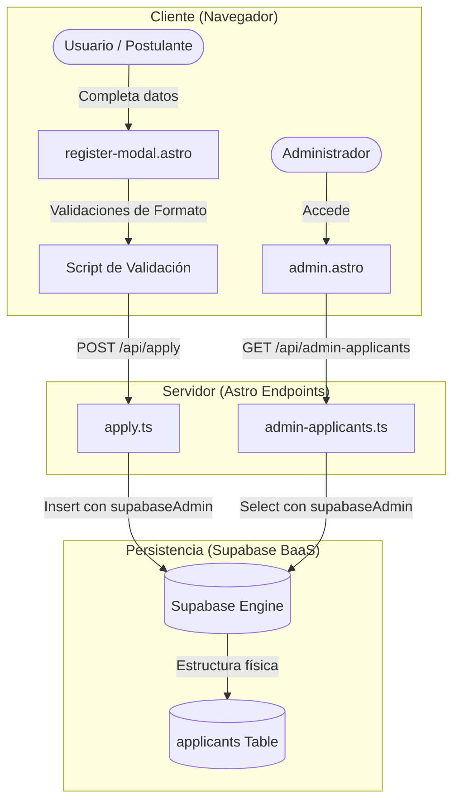
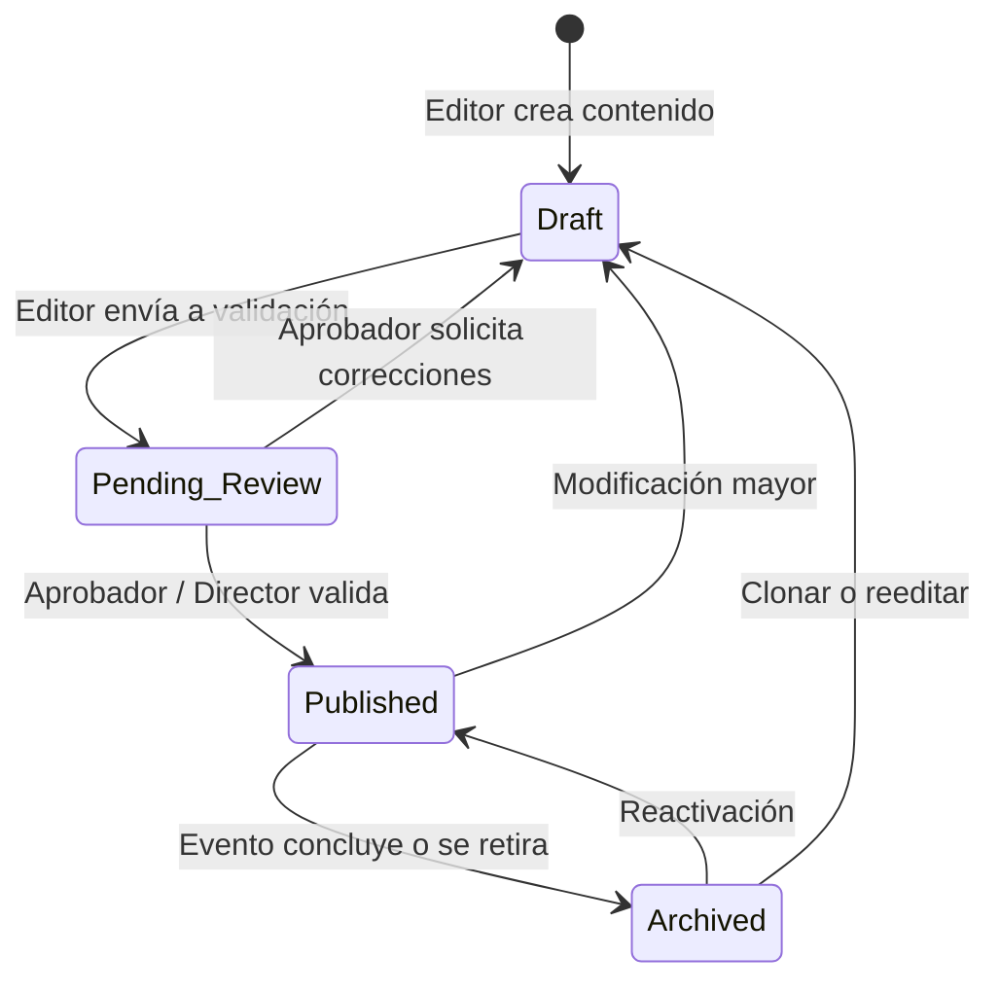

# Arquitectura del Sistema

## 1. Propósito del sistema

El propósito principal de la Landing Page de Unicode es centralizar y potenciar la presencia digital de la organización, sirviendo como el canal oficial de comunicación para:
* **Visibilidad institucional:** Presentar la misión, visión y estructura interna de Unicode a la comunidad universitaria y profesional.
* **Difusión de áreas especializadas:** Explicar detalladamente las funciones y aportes de cada una de las divisiones de la organización: Investigación y Desarrollo (`ID`), Relaciones Públicas (`RRPP`), Gestión de Talento Humano (`GTH`), Académica (`ACD`) y Dirección de Creación y Contenido (`DCC`).
* **Exposición de portafolio:** Difundir los proyectos tecnológicos desarrollados, eventos organizados y logros de los miembros.
* **Atracción de talento:** Servir de plataforma de reclutamiento mediante el módulo interactivo de Convocatoria para captar nuevos integrantes.

---

## 2. Vista general de la arquitectura

El sistema está diseñado bajo una arquitectura de **Frontend en el cliente integrado con Backend-as-a-Service (BaaS)** mediante el patrón de componentes web:

* **Cliente Frontend:** Compuesto por interfaces responsivas desarrolladas en Astro y estilizadas de manera dinámica. Los componentes manejan su propia lógica de presentación y eventos.
* **Integración Directa BaaS:** La persistencia de datos y la administración de los registros se delegan en la nube a través del SDK oficial de Supabase.
* **Acceso Seguro:** El cliente se comunica con el backend interactuando con las variables expuestas en el navegador:
  * `SUPABASE_URL`: Dirección HTTP de acceso al proyecto.
  * `SUPABASE_ANON_KEY`: Token público para autenticación del cliente.
  * La seguridad de los datos está blindada mediante políticas de seguridad a nivel de fila (**RLS - Row Level Security**) configuradas en Supabase, lo cual asegura que un cliente anónimo solo pueda realizar inserciones (`INSERT`), bloqueando cualquier lectura (`SELECT`) o modificación.

---

## 3. Componentes principales y flujos

El sistema se estructura en tres capas principales:

1. **Frontend UI:** Componentes como `register-modal.astro` y la página `admin.astro` que interactúan directamente con el usuario.
2. **Capa de validación y control:** Funciones de validación implementadas en los scripts del cliente y endpoints de API en Astro (`/api/apply` y `/api/admin-applicants`) que actúan como middleware de validación dura, sanitización contra XSS y control de acceso.
3. **Persistencia (Base de Datos):** La capa de datos implementada en Supabase que expone la tabla `applicants`.

### Flujo de datos para Postulación:
* El postulante completa los datos solicitados en el formulario de la interfaz gráfica.
* Los scripts del frontend ejecutan validaciones previas de longitud, formato de correo y obligatoriedad.
* Se realiza una petición HTTP `POST` hacia la ruta `/api/apply`.
* El endpoint de la API recibe la petición, sanitiza los campos en inglés e invoca al SDK de Supabase con permisos administrativos (`supabaseAdmin`) para realizar la inserción segura en la tabla `applicants`.

---

## 4. Diagrama general del sistema

El siguiente diagrama detalla los flujos de comunicación y persistencia entre los diferentes componentes del sistema:



---

## 5. Riesgos técnicos conocidos

* **Dependencia de infraestructura de terceros:** El sistema depende directamente del estado operativo del servicio en la nube de Supabase y la latencia de su API externa.
* **Exposición pública de variables del cliente:** La llave `SUPABASE_ANON_KEY` y la `SUPABASE_URL` se cargan en el cliente. Si bien es el estándar de Supabase, obliga a tener una configuración de políticas RLS perfectamente auditada en la tabla `applicants` para evitar que usuarios malintencionados lean o borren datos de otros postulantes utilizando herramientas externas.
* **Validaciones exclusivas:** Las limitaciones de validación estricta de formatos a nivel de interfaz de usuario deben estar perfectamente sincronizadas con las restricciones físicas de la tabla en PostgreSQL (como la restricción `UNIQUE` para el campo `email`) para evitar excepciones del servidor no controladas.

---

## 6. Arquitectura del CMS (Monorepo Híbrido Astro + Supabase)

El **CMS de UNICODE** se incorpora dentro del mismo repositorio bajo una arquitectura de **Monorepo Unificado**, permitiendo gestionar el contenido dinámico del sitio (Eventos y Parámetros Públicos de Convocatoria en la Primera Entrega) reutilizando al 100% los componentes de diseño, estilos Tailwind CSS y la infraestructura existente de Supabase.

### 6.1. Estructura Modular de Directorios

La estructura dentro de `/src/` y `/supabase/` aísla las responsabilidades del CMS sin generar colisiones con la landing pública:

```text
/
├── docs/                        # Documentación técnica de arquitectura y contratos
│   └── arquitectura.md          # Esta especificación
├── src/
│   ├── types/
│   │   ├── cms.ts               # Contratos TypeScript de entidades, DTOs y permisos
│   │   └── index.ts             # Exportador unificado de interfaces del proyecto
│   ├── pages/
│   │   ├── events.astro         # Vista pública SSR con caché SWR (consume cms_events)
│   │   ├── call.astro           # Vista pública SSR de convocatoria (consume recruitment_config)
│   │   ├── admin/
│   │   │   ├── index.astro      # Dashboard central del panel administrativo
│   │   │   ├── recruitment.astro# Panel de operaciones de convocatoria (existente)
│   │   │   ├── events/          # Vistas CMS para gestión de eventos (listado, edición, creación)
│   │   │   └── call/            # Vista CMS para parámetros públicos de convocatoria
│   │   └── api/
│   │       └── cms/             # Endpoints internos protegidos para operaciones CRUD
│   │           ├── events/      # Handlers: GET, POST, PUT, DELETE, transition-status
│   │           ├── call-config/ # Handlers para configuración pública de /call
│   │           └── media/       # Handlers para subida/firma en Supabase Storage
│   └── lib/
│       ├── cms/                 # Lógica de negocio y servicios del CMS
│       │   ├── events-service.ts# Servicios CRUD y validaciones de estado para eventos
│       │   ├── call-service.ts  # Servicios para lectura/escritura de parámetros en recruitment_config
│       │   └── permissions.ts   # Verificación de roles y area_scope
│       └── supabase.ts          # Clientes Supabase (cliente anónimo y service_role)
└── supabase/
    └── migrations/              # Scripts DDL para tablas cms_*, RLS y Storage
```

### 6.2. Estrategia de Renderizado Híbrido (SSR + Caché SWR)

Para balancear la inmediatez en la publicación de contenido con el rendimiento extremo exigido por UNICODE (**LCP < 2.5s**):

1. **Renderizado en el Servidor (SSR Bajo Demanda):**
   - Las vistas dinámicas alimentadas por el CMS (`/events`, `/call`) y las rutas protegidas del panel administrativo (`/admin/*`) se configuran con `export const prerender = false` en Astro (adaptador de servidor `@astrojs/vercel` o `@astrojs/node`).
   - Se descarta el uso de webhooks SSG para regeneración estática, garantizando que cuando un director o DCC aprueba un cambio, este sea visible de inmediato.

2. **Estrategia de Caché SWR (Stale-While-Revalidate):**
   - **Vistas Públicas Dinámicas (`/events`, `/call`):** Se emiten con la cabecera:
     ```http
     Cache-Control: public, s-maxage=60, stale-while-revalidate=600
     ```
     *Comportamiento:* Las peticiones son servidas instantáneamente desde el CDN/Edge durante 60 segundos (`s-maxage=60`). Entre el segundo 60 y el segundo 660, el usuario recibe la versión en caché al instante mientras el servidor revalida en segundo plano (`stale-while-revalidate=600`).
   - **Vistas Administrativas y Endpoints de Mutación (`/admin/*`, `/api/cms/*`):** Se emiten con control de caché estricto:
     ```http
     Cache-Control: no-store, no-cache, must-revalidate, proxy-revalidate, max-age=0
     ```

### 6.3. Ciclo de Vida Editorial (Flujo de 3 Estados)

Ningún contenido se publica directamente en la web sin validación previa. Todos los registros de `cms_events` siguen este flujo de transiciones:



* **Borrador (`draft`):** Contenido en preparación con datos parciales o completos e imágenes preliminares. Solo visible por el creador y editores con el mismo `area_scope`.
* **En Revisión (`pending_review`):** Contenido finalizado esperando aprobación de redacción, diseño y enlaces por parte del Director de Área o DCC.
* **Publicado (`published`):** Aprobado oficialmente y visible al público en `ccunicode.org`.
* **Archivado (`archived`):** Evento concluido o retirado de la cartelera principal, conservado en base de datos para historial y métricas sin borrado destructivo.

### 6.4. Modelo de Permisos Desacoplado (RBAC & `area_scope`)

Para resolver el requerimiento organizativo sin bloquear la arquitectura ante la decisión de Presidencia (centralización en DCC vs. autogestión por áreas), el sistema implementa un modelo desacoplado:

* **Roles del CMS:**
  * `admin`: Control total del sistema, configuración global y publicación en todas las áreas.
  * `approver`: Directores o aprobadores de área con capacidad de transición a `published` y `archived`.
  * `editor`: Miembros creadores de contenido autorizados para crear y editar borradores (`draft` y `pending_review`).
* **Alcance por Área (`area_scope`):**
  * Valores: `'ID' | 'RRPP' | 'GTH' | 'ACD' | 'DCC' | 'LGE' | 'FIN' | 'ALL'`.
  * Un usuario con `area_scope: 'DCC'` puede gestionar contenidos de eventos y novedades, mientras que un usuario con `area_scope: 'ALL'` (Dirección / Presidencia) tiene acceso global transversal.

