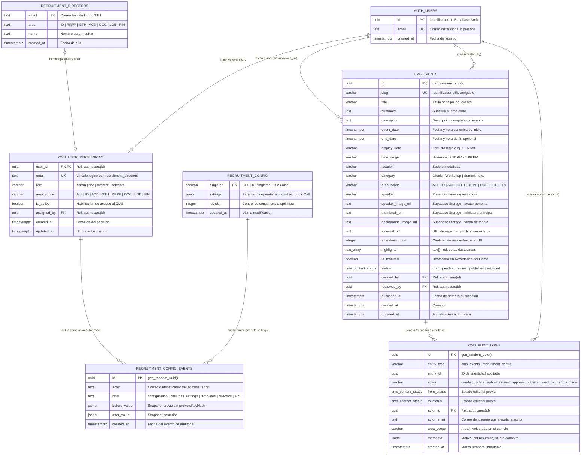

# Base de Datos

## 1. Tecnologías y Configuración

El motor de persistencia para la landing page de Unicode utiliza una base de datos **PostgreSQL** administrada a través de la plataforma de backend como servicio **Supabase**.

La interacción y la ingesta de datos desde el cliente frontend se realizan de manera segura a través de la API REST nativa utilizando dos variables de entorno de acceso público:
* `SUPABASE_URL`: Endpoint seguro del API REST del proyecto.
* `SUPABASE_ANON_KEY`: Llave anónima pública del cliente para el control básico de acceso.

El acceso directo de lectura y escritura no autorizada a las tablas está restringido mediante **Políticas de Seguridad a Nivel de Fila (RLS - Row Level Security)**. La política de la base de datos permite exclusivamente operaciones de inserción (`INSERT`) originadas desde el cliente de la landing page para registrar postulaciones, manteniendo bloqueadas las operaciones de selección (`SELECT`), actualización (`UPDATE`) y eliminación (`DELETE`) para proteger datos sensibles de accesos no autorizados.

---

## 2. Modelo de Datos (Tabla: applicants)

Estructura física de la tabla `applicants` utilizada para consolidar las postulaciones de la convocatoria:

| Columna | Tipo de dato | Restricciones (Constraints) | Descripción (Propósito) |
| :--- | :--- | :--- | :--- |
| `id` | `uuid` | Primary Key, `default uuid_generate_v4()` | Identificador único global autogenerado para cada postulación. |
| `first_name` | `varchar(150)` | Not Null | Nombre o nombres del postulante. |
| `last_name` | `varchar(150)` | Not Null | Apellido o apellidos del postulante. |
| `email` | `varchar(150)` | Unique, Not Null | Correo electrónico de contacto único de cada postulante. |
| `phone` | `varchar(20)` | Not Null | Teléfono móvil o fijo de contacto del postulante. |
| `career` | `varchar(150)` | Not Null | Escuela profesional o carrera universitaria en curso. |
| `first_choice_area` | `varchar(150)` | Not Null, Check (IN ('ID', 'RRPP', 'GTH', 'ACD', 'DCC')) | Primera opción de área de postulación dentro de la organización. |
| `university` | `varchar(150)` | Not Null | Universidad de origen del postulante. |
| `university_semester` | `varchar(20)` | Not Null | Semestre o ciclo académico actual del postulante. |
| `application_reason` | `text` | Not Null | Motivos de postulación detallados para el ingreso a la organización. |
| `second_choice_area` | `varchar(150)` | Nullable, Check (NULL or IN ('ID', 'RRPP', 'GTH', 'ACD', 'DCC')) | Segunda opción opcional de área de postulación dentro de la organización. |
| `created_at` | `timestamptz` | Default: `now()` | Fecha y hora exacta en la que se realizó el registro en el sistema. |

---

## 3. Restricciones e Integridad de Datos (Constraints & Indexes)

* **Restricción de Unicidad (`UNIQUE`):** Implementada en la columna `email` para garantizar la integridad lógica del proceso de admisión, previniendo que un mismo correo electrónico pueda registrar múltiples postulaciones dentro de la misma base de datos.
* **Restricción de Verificación (`CHECK`):** Las columnas `first_choice_area` y `second_choice_area` están sujetas a una restricción de validación estricta a nivel de base de datos para asegurar que únicamente contengan las siglas válidas de las áreas autorizadas de la organización: `'GTH'` (Gestión de Talento Humano), `'ACD'` (Académica), `'RRPP'` (Relaciones Públicas), `'DCC'` (Dirección de Creación y Contenido) e `'ID'` (Investigación y Desarrollo).
* **Integración con Frontend:** Estas restricciones a nivel de esquema actúan como la última línea de defensa de la integridad de los datos. En el frontend, el formulario de la landing valida la estructura del payload (formatos de correo, caracteres permitidos, obligatoriedad y límites de caracteres) de manera equivalente antes del envío, garantizando una experiencia de usuario consistente y un flujo de datos limpio.

---

## 4. Sentencias de Creación (DDL SQL)

Sentencia DDL SQL declarativa completa para inicializar la tabla con sus respectivas restricciones de validación e integridad:

```sql
-- Create applicants table for landing page registrations
CREATE TABLE applicants (
    -- Unique identifier using uuid
    id UUID PRIMARY KEY DEFAULT uuid_generate_v4(),
    
    -- Personal details
    first_name VARCHAR(150) NOT NULL,
    last_name VARCHAR(150) NOT NULL,
    
    -- Contact details
    email VARCHAR(150) UNIQUE NOT NULL,
    phone VARCHAR(20) NOT NULL,
    
    -- Academic info
    career VARCHAR(150) NOT NULL,
    university VARCHAR(150) NOT NULL,
    university_semester VARCHAR(20) NOT NULL,
    
    -- Application options constrained to valid areas
    first_choice_area VARCHAR(150) NOT NULL CHECK (first_choice_area IN ('ID', 'RRPP', 'GTH', 'ACD', 'DCC')),
    second_choice_area VARCHAR(150) NULL CHECK (second_choice_area IS NULL OR second_choice_area IN ('ID', 'RRPP', 'GTH', 'ACD', 'DCC')),
    
    -- Text area for statement of purpose
    application_reason TEXT NOT NULL,
    
    -- Auto-generated timestamp
    created_at TIMESTAMPTZ DEFAULT now() NOT NULL
);

-- Performance Indexes
CREATE INDEX idx_applicants_choices ON applicants(first_choice_area, second_choice_area);
CREATE INDEX idx_applicants_created_at ON applicants(created_at DESC);
```

---

## 5. Gestión de Migraciones y Semillas (Seeds)

En la fase actual del desarrollo, la definición de la estructura física de la base de datos se almacena en el archivo declarativo [schema.sql](../../supabase/schema.sql) ubicado en el directorio `/supabase/` en la raíz.

### Pasos para replicar el esquema en un nuevo proyecto de Supabase:
1. **Acceso al Dashboard**: Inicie sesión en el panel de control de **Supabase** y navegue hacia el proyecto correspondiente.
2. **Editor de SQL**: En la barra lateral izquierda, seleccione la herramienta **SQL Editor**.
3. **Cargar Estructura**: Cree una nueva consulta (*New Query*), copie la totalidad del contenido del archivo `supabase/schema.sql` y péguelo en el editor SQL.
4. **Ejecución**: Presione el botón **Run** para crear la tabla `applicants` con sus respectivas restricciones de validación y los índices de rendimiento optimizados.
5. **Configuración RLS**: Asegúrese de ir a la sección **Database > Policies** en Supabase para habilitar las políticas de seguridad a nivel de fila (*Row Level Security*), configurando permisos exclusivos de `INSERT` para roles públicos y restringiendo lecturas a la capa del servidor.

---

# Módulo CMS Unicode — Entrega 1 (Eventos y Convocatoria)

> **Referencia de diseño:** Issue **CMS-1** (`[Doc & BD] Especificación del Modelo Entidad-Relación (cms_*) y Articulación con recruitment_config`).

## 6. Decisiones de Arquitectura y Flujo Editorial Dual

En el proyecto de Supabase en producción coexisten la tabla histórica de postulantes (`applicants` / `postulantes`) y las tablas operativas del sistema de reclutamiento (`recruitment_*`, creadas en `supabase/migrations/20261002_recruitment.sql` y migraciones posteriores). Para incorporar **CMS Unicode** dentro del mismo monorepo sin colisiones ni regresiones sobre el flujo activo de `/call` y `/postular`, aplican las siguientes reglas cerradas:

1. **Aislamiento nominal con prefijo `cms_`:** Toda entidad nueva del CMS emplea el prefijo `cms_` (`cms_events`, `cms_audit_logs`, `cms_user_permissions`) y el tipo enumerado `cms_content_status`.
2. **Reutilización sin duplicación en Convocatoria:** No se crea una tabla paralela `call_settings`. La configuración pública y operativa de `/call` continúa persistida en el registro singleton `public.recruitment_config` (`settings jsonb`, `revision int4`, `updated_at timestamptz`), auditada en `public.recruitment_config_events`.
3. **Ciclo de vida editorial en 4 estados (`cms_content_status`):**
   - `draft`: Borrador en edición (visible solo para el equipo autorizado del área y DCC/Admin).
   - `pending_review`: Enviado por un Delegado de Área para revisión y aprobación.
   - `published`: Contenido aprobado y visible públicamente en el sitio web (`www.ccunicode.org`).
   - `archived`: Contenido retirado de la vista pública sin pérdida de historial ni auditoría.
4. **Flujo editorial dual y control de permisos por rol y área (`area_scope`):**

| Rol (`cms_user_permissions.role`) | Alcance (`area_scope`) | Flujo Editorial | Permisos sobre `cms_events` y `recruitment_config` |
| :--- | :--- | :--- | :--- |
| **Administrador (`admin`)** | `'ALL'` | **1 paso** (publicación directa) | Crea, edita, publica, archiva y aprueba contenido en todas las áreas; gestiona permisos en `cms_user_permissions` y parámetros de `/call`. |
| **DCC (`dcc`)** | `'ALL'` | **1 paso** (publicación directa) | Crea, edita, publica, archiva y aprueba eventos de todas las áreas y novedades institucionales; administra contenido público de `/call`. |
| **Director de Área (`director`)** | `'<AREA>'` (`ID`, `ACD`, `GTH`, `RRPP`, `DCC`, `LGE`, `FIN`) | **1 paso** + **Aprobador** | Crea, edita, publica y archiva directamente dentro de su área; aprueba (`pending_review` → `published`) o devuelve a borrador (`pending_review` → `draft`) los envíos de su delegado. |
| **Delegado de Área (`delegate`)** | `'<AREA>'` (`ID`, `ACD`, `GTH`, `RRPP`, `DCC`, `LGE`, `FIN`) | **2 pasos** (requiere aprobación) | Crea borradores (`draft`) dentro de su área y los envía a revisión (`pending_review`). No puede transicionar directamente a `published` ni `archived`. |

---

## 7. Diagrama Entidad-Relación (`cms_*` y Tablas Articuladas)

El siguiente diagrama modela las tablas nuevas del módulo CMS (`cms_events`, `cms_audit_logs`, `cms_user_permissions`), su vínculo con `auth.users` de Supabase Auth y su articulación con las tablas existentes de reclutamiento (`recruitment_directors`, `recruitment_config` y `recruitment_config_events`).



---

## 8. Diccionario de Datos Detallado

### 8.1 Tipo Enumerado `public.cms_content_status`

| Valor | Significado | Visibilidad Pública | Transiciones Permitidas |
| :--- | :--- | :--- | :--- |
| `'draft'` | Borrador inicial o devuelto tras revisión. | No | → `'pending_review'` (Delegado) / → `'published'` (Director, DCC, Admin) / → `'archived'` (Director, DCC, Admin). |
| `'pending_review'` | Enviado por un Delegado esperando aprobación de su Director o DCC. | No | → `'published'` (Aprobado) / → `'draft'` (Observado o devuelto) / → `'archived'`. |
| `'published'` | Contenido oficial visible en `/`, `/events` y endpoints públicos. | Sí | → `'draft'` (Despublicar para edición) / → `'archived'` (Retirar del sitio). |
| `'archived'` | Evento histórico oculto del sitio público conservado para auditoría. | No | → `'draft'` (Restaurar) / → `'published'` (Republicar por Director, DCC o Admin). |

### 8.2 Tabla `public.cms_events`

Consolidación relacional para **Próximos Eventos**, **Eventos Realizados** y la sección **Novedades** del inicio, cubriendo el 100% de las propiedades consumidas por los componentes actuales de Astro (`src/data/events.ts`, `src/components/components-events/upcoming-events.astro`, `src/components/components-events/completed-events.astro` y `src/components/components-home/news.astro`).

| Columna | Tipo de dato | Restricciones (Constraints) | Descripción (Propósito y Consumo en Frontend) |
| :--- | :--- | :--- | :--- |
| `id` | `uuid` | `PRIMARY KEY DEFAULT gen_random_uuid()` | Identificador único global autogenerado del evento. |
| `slug` | `varchar(160)` | `UNIQUE NOT NULL`, Check formato kebab-case | Identificador único legible para URLs y trazabilidad (ej. `discover-data-world-2026`). |
| `title` | `varchar(200)` | `NOT NULL` | Título principal del evento (usado en tarjetas de realizados, novedades y título de próximos). |
| `summary` | `text` | `NULL` | Resumen corto o lema/tópico destacado (ej. `topic` en `upcoming-events.astro` o extracto para `news-card.astro`). |
| `description` | `text` | `NOT NULL` | Descripción completa mostrada en el detalle de la tarjeta. |
| `event_date` | `timestamptz` | `NOT NULL` | Fecha y hora canónica del evento (con zona horaria). Determina orden cronológico y separación automática entre próximos (`>= now()`) y realizados (`< now()`). |
| `end_date` | `timestamptz` | `NULL`, `CHECK (end_date IS NULL OR end_date >= event_date)` | Fecha/hora de cierre para eventos de múltiples días (ej. Software Week). |
| `display_date` | `varchar(80)` | `NULL` | Etiqueta textual opcional para fechas aproximadas o rangos (ej. `"23 May"`, `"1 – 5 Set"`, `"Sep 2025"`). Si es `NULL`, se formatea `event_date` en zona `America/Lima`. |
| `time_range` | `varchar(80)` | `NULL` | Horario legible mostrado en `upcoming-events.astro` (ej. `"9:30 AM – 1:00 PM"`, `"Por definir"`). |
| `location` | `varchar(150)` | `NOT NULL` | Lugar presencial o modalidad del evento (ej. `"Auditorio FIIS"`, `"Auditorio CTIC – UNI"`). |
| `category` | `varchar(60)` | `NOT NULL`, Check catálogo oficial | Categoría visual mapeada a `categoryBadge`: `'Hackathon'`, `'Workshop'`, `'Charla'`, `'Competencia'`, `'Panel'`, `'Integración'`, `'Social'`, `'Clase'`, `'Summit'`. |
| `area_scope` | `varchar(20)` | `NOT NULL`, Check siglas válidas | Área responsable del evento para control editorial RLS: `'ALL'` (institucional), `'ID'`, `'ACD'`, `'GTH'`, `'RRPP'`, `'DCC'`, `'LGE'`, `'FIN'`. |
| `speaker` | `varchar(200)` | `NULL` | Nombre del ponente, invitados o área organizadora (mapea tanto a `UpcomingEvent.speaker` como a `CompletedEvent.speaker`). |
| `speaker_image_url` | `text` | `NULL` | URL pública o ruta en Supabase Storage para la imagen del ponente/mascota (`UpcomingEvent.speakerImage`). |
| `thumbnail_url` | `text` | `NOT NULL` | URL pública o ruta en Supabase Storage (WebP optimizada) para la miniatura principal en realizados (`CompletedEvent.image`) y Home (`NewsCard.image`). |
| `background_image_url` | `text` | `NULL` | URL pública o ruta en Supabase Storage para la imagen de fondo de la tarjeta en `upcoming-events.astro` (`UpcomingEvent.backgroundImage`). |
| `external_url` | `text` | `NULL` | Enlace externo de inscripción (`UpcomingEvent.registrationUrl`, ej. Luma) o publicación/reseña (`CompletedEvent.link`, ej. Instagram/LinkedIn/Facebook). |
| `attendees_count` | `integer` | `NOT NULL DEFAULT 0`, `CHECK (attendees_count >= 0)` | Conteo de asistentes del evento realizado; alimenta el KPI animado `totalAsistentes` en `completed-events.astro`. |
| `highlights` | `text[]` | `NOT NULL DEFAULT '{}'` | Arreglo de palabras clave renderizadas como etiquetas `#tag` en la grilla desktop de `completed-events.astro`. |
| `is_featured` | `boolean` | `NOT NULL DEFAULT false` | Indica si el evento debe priorizarse en el carrusel **Novedades** (`news.astro`) de la página principal. |
| `status` | `cms_content_status` | `NOT NULL DEFAULT 'draft'` | Estado del flujo editorial (`'draft'`, `'pending_review'`, `'published'`, `'archived'`). |
| `created_by` | `uuid` | `NULL`, FK → `auth.users(id) ON DELETE SET NULL` | UUID del usuario autenticado (Delegado, Director, DCC o Admin) que creó el registro. |
| `reviewed_by` | `uuid` | `NULL`, FK → `auth.users(id) ON DELETE SET NULL` | UUID del Director, DCC o Admin que aprobó/revisó la publicación. |
| `published_at` | `timestamptz` | `NULL` | Marca temporal de publicación oficial (asignada automáticamente al pasar a `'published'`). |
| `created_at` | `timestamptz` | `NOT NULL DEFAULT now()` | Fecha y hora de creación del registro. |
| `updated_at` | `timestamptz` | `NOT NULL DEFAULT now()` | Fecha y hora de última modificación (actualizada automáticamente vía trigger). |

#### Mapeo Directo hacia los Componentes Actuales de Astro (`src/`)

| Propiedad Actual en `src/data/events.ts` | Componente Consumidor | Columna en `public.cms_events` | Regla de Compatibilidad |
| :--- | :--- | :--- | :--- |
| `UpcomingEvent.speaker` | `upcoming-events.astro` | `COALESCE(speaker, title)` | Si `speaker` se usa como cabecera del próximo evento, mantiene compatibilidad visual exacta. |
| `UpcomingEvent.topic` | `upcoming-events.astro` | `summary` | Lema o subtítulo entre comillas de la tarjeta. |
| `UpcomingEvent.date` / `CompletedEvent.date` | `upcoming-events.astro`, `completed-events.astro` | `COALESCE(display_date, format(event_date))` | Permite fechas exactas y rangos textuales (`"1 – 5 Set"`). |
| `UpcomingEvent.time` | `upcoming-events.astro` | `time_range` | Texto de horario o `"Por definir"`. |
| `UpcomingEvent.speakerImage` | `upcoming-events.astro` | `COALESCE(speaker_image_url, thumbnail_url)` | Bucket de Supabase Storage. |
| `UpcomingEvent.backgroundImage` | `upcoming-events.astro` | `COALESCE(background_image_url, thumbnail_url)` | Bucket de Supabase Storage. |
| `UpcomingEvent.registrationUrl` / `CompletedEvent.link` | `upcoming-events.astro`, `completed-events.astro`, `news.astro` | `external_url` | Si es `NULL` o vacío en próximos eventos, el botón muestra `"Próximamente"`. |
| `CompletedEvent.title` / `Novedad.title` | `completed-events.astro`, `news-card.astro` | `title` | Título principal de la tarjeta. |
| `CompletedEvent.attendees` | `completed-events.astro` | `attendees_count` | Suma total para el contador KPI de asistentes. |
| `CompletedEvent.category` | `completed-events.astro` | `category` | Mapeado al diccionario `categoryBadge` y KPI de categorías. |
| `CompletedEvent.image` / `Novedad.image` | `completed-events.astro`, `news-card.astro` | `thumbnail_url` | Miniatura principal WebP en Supabase Storage. |
| `CompletedEvent.highlights` | `completed-events.astro` | `highlights` | Etiquetas `#tag` mostradas en la tarjeta desktop. |

### 8.3 Tabla `public.cms_audit_logs`

Registro inmutable (*append-only*) de trazabilidad editorial para todas las operaciones relevantes dentro del módulo CMS (cambios de estado en `cms_events` y auditoría complementaria cuando el CMS muta parámetros de entidades administradas).

| Columna | Tipo de dato | Restricciones (Constraints) | Descripción (Propósito) |
| :--- | :--- | :--- | :--- |
| `id` | `uuid` | `PRIMARY KEY DEFAULT gen_random_uuid()` | Identificador único del evento de auditoría. |
| `entity_type` | `varchar(50)` | `NOT NULL` | Nombre lógico de la entidad afectada (ej. `'cms_events'`, `'recruitment_config'`). |
| `entity_id` | `uuid` | `NOT NULL` | UUID del registro afectado (para `recruitment_config`, se usa un UUID determinístico de singleton o referencia en `metadata`). |
| `action` | `varchar(50)` | `NOT NULL` | Acción ejecutada: `'create'`, `'update'`, `'submit_review'`, `'approve_publish'`, `'reject_to_draft'`, `'archive'`, `'restore'`. |
| `from_status` | `cms_content_status` | `NULL` | Estado editorial anterior (es `NULL` en la creación inicial). |
| `to_status` | `cms_content_status` | `NULL` | Estado editorial resultante de la acción. |
| `actor_id` | `uuid` | `NULL`, FK → `auth.users(id) ON DELETE SET NULL` | Referencia al usuario autenticado que ejecutó la operación. |
| `actor_email` | `text` | `NOT NULL` | Correo electrónico del actor capturado al momento del cambio (preserva trazabilidad si se elimina la cuenta). |
| `area_scope` | `varchar(20)` | `NULL` | Área asociada a la operación (`'ALL'`, `'ID'`, `'ACD'`, `'GTH'`, `'RRPP'`, `'DCC'`, `'LGE'`, `'FIN'`). |
| `metadata` | `jsonb` | `NOT NULL DEFAULT '{}'::jsonb` | Contexto adicional estructurado: `title`, `slug`, `review_comment` (motivo de rechazo/aprobación), `changed_fields`, etc. |
| `created_at` | `timestamptz` | `NOT NULL DEFAULT now()` | Marca temporal exacta del registro de auditoría. |

### 8.4 Tabla de Autorización `public.cms_user_permissions` (Articulación con `auth.users` y `recruitment_directors`)

Permite aplicar **Row Level Security (RLS)** granular directamente en PostgreSQL para el flujo editorial dual, evitando depender únicamente de validaciones en cliente o contraseñas compartidas.

| Columna | Tipo de dato | Restricciones (Constraints) | Descripción (Propósito) |
| :--- | :--- | :--- | :--- |
| `user_id` | `uuid` | `PRIMARY KEY`, FK → `auth.users(id) ON DELETE CASCADE` | Identificador del usuario en Supabase Auth. |
| `email` | `text` | `UNIQUE NOT NULL`, `CHECK (email = lower(email))` | Correo normalizado; permite vincular y homologar cuentas registradas en `public.recruitment_directors(email)`. |
| `role` | `varchar(20)` | `NOT NULL`, `CHECK (role IN ('admin', 'dcc', 'director', 'delegate'))` | Rol operativo dentro del CMS. |
| `area_scope` | `varchar(20)` | `NOT NULL`, `CHECK (area_scope IN ('ALL', 'ID', 'ACD', 'GTH', 'RRPP', 'DCC', 'LGE', 'FIN'))` | Ámbito de escritura. Regla `CHECK`: `'admin'` y `'dcc'` deben tener `area_scope = 'ALL'`; `'director'` y `'delegate'` deben tener un área específica (`area_scope <> 'ALL'`). |
| `is_active` | `boolean` | `NOT NULL DEFAULT true` | Interruptor de revocación inmediata sin borrar trazabilidad histórica. |
| `assigned_by` | `uuid` | `NULL`, FK → `auth.users(id) ON DELETE SET NULL` | Administrador que otorgó o modificó el permiso. |
| `created_at` | `timestamptz` | `NOT NULL DEFAULT now()` | Fecha de alta en el CMS. |
| `updated_at` | `timestamptz` | `NOT NULL DEFAULT now()` | Última actualización de rol o ámbito. |

---

## 9. Contrato JSONB para `recruitment_config.settings` (Integración con `/call`)

### 9.1 Propiedades Existentes Inmutables (Retrocompatibilidad)

De acuerdo con `src/lib/recruitment/types.ts`, `src/lib/recruitment/validation.ts` y la función PostgreSQL `public.recruitment_public_config()` (actualizada en `supabase/migrations/20261003_recruitment_preview.sql`), el campo `recruitment_config.settings` almacena actualmente las siguientes claves de nivel raíz que **no deben renombrarse ni eliminarse**:

| Propiedad Raíz Actual | Tipo JSON / TS | Consumidores Críticos Existentes |
| :--- | :--- | :--- |
| `enabled` | `boolean` | `recruitment_assert_open()`, `HeroCall.astro`, `/api/recruitment/config` |
| `title` | `string` | `HeroCall.astro`, plantillas de correo (`{{title}}`), `/admin/recruitment` |
| `opensAt` | `string \| null` (ISO-8601 con zona) | `recruitment_assert_open()`, countdown de apertura en `HeroCall.astro` |
| `closesAt` | `string \| null` (ISO-8601 con zona) | `recruitment_assert_open()`, countdown de cierre en `HeroCall.astro`, `recruitment_expire_drafts()` |
| `extensionAt` | `string \| null` (ISO-8601 con zona) | `recruitment_assert_open()`, prórroga automática (`20261017_recruitment_prorroga_reactivacion.sql`) |
| `emailPausedUntil` | `string \| null` (opcional) | `processEmails()` en `src/lib/recruitment/service.ts` |
| `previewKeyHash` | `string` (opcional, solo servidor) | `recruitment_preview_active()` (siempre excluido en `recruitment_public_config()` y `recruitment_admin_config()`) |
| `draftsPerIpPerHour` | `integer` (opcional, default `30`) | `recruitment_create_draft()` |
| `maxApplicants` | `integer` | `recruitment_public_config()`, `recruitment_create_draft()`, `recruitment_submit()` |
| `minAvailabilityHours` | `number \| null` | `recruitment_assert_open()`, `recruitment_submit()` |
| `maxVideoSeconds` | `integer` | `recruitment_begin_upload()`, `recruitment_complete_upload()`, `validateConfig()` |
| `maxVideoBytes` | `integer` | `recruitment_begin_upload()`, `validateConfig()` |
| `questionsPerCategory` | `integer` | `recruitment_create_draft()`, `validateConfig()` |
| `preparationSeconds` | `integer` | `recruitment-form.ts` |
| `inactivityHours` | `integer` | `recruitment_expire_drafts()` |
| `shortCasePrompt` | `string` | `/postular` |
| `storageProvider` | `'drive' \| 'supabase'` | `videoSession()` (excluido de `recruitment_public_config()`) |
| `thresholds` | `{ affinity, written, video }` | Panel administrativo (excluido de `recruitment_public_config()`) |
| `areas` | `RecruitmentArea[]` (`{ id, name, enabled, quota }`) | `HeroCall.astro` (filtra íconos de áreas habilitadas), `recruitment_submit()`, `recruitment_transition()` |
| `questions` | `RecruitmentQuestion[]` | `recruitment_create_draft()` (excluido de `recruitment_public_config()`) |
| `videoRubric` | `VideoRubricCriterion[]` | Evaluación de videos en `/admin/recruitment` |

> **Nota crítica de implementación (`src/lib/recruitment/validation.ts`):** La función `recruitment_public_config()` en PostgreSQL ya retorna `c - 'questions' - 'thresholds' - 'storageProvider' - 'previewKeyHash'`, por lo que cualquier propiedad adicional agregada bajo `settings.publicCall` es entregada automáticamente a `/call`. Sin embargo, `validateConfig()` en `src/lib/recruitment/validation.ts` reconstruye actualmente el objeto `RecruitmentConfig` con una lista fija de propiedades; por tanto, al implementar el guardado en código, se deberá incluir `publicCall` en `validateConfig()` (o usar un RPC de actualización parcial que haga merge sobre `settings`) para evitar que guardar desde `/admin/recruitment` borre los datos editados desde el CMS.

### 9.2 Esquema TypeScript Propuesto (`settings.publicCall`)

Para administrar desde el CMS la vista pública `/call` (estado abierta/cerrada, cronograma/fechas clave, estado/enlace del formulario y requisitos/perfiles por las 6 áreas visibles en `HeroCall.astro`: `ID`, `ACD`, `GTH`, `RRPP`, `DCC`, `LGE`), se añade el nodo opcional `publicCall` dentro de `recruitment_config.settings`:

```typescript
export type PublicCallAreaId = 'ID' | 'ACD' | 'GTH' | 'RRPP' | 'DCC' | 'LGE';

export interface RecruitmentScheduleStage {
  id: string;                 // Ej. "inscripciones", "entrevistas", "resultados"
  order: number;              // Orden ascendente de visualización en /call
  title: string;              // Ej. "Cierre de postulaciones y envío de video"
  description: string;        // Detalle breve de la etapa
  startAt: string | null;     // ISO-8601 con zona horaria (America/Lima -> -05:00)
  endAt: string | null;       // ISO-8601 con zona horaria
  displayDate: string;        // Texto amigable ej. "15 – 28 de Marzo"
  status: 'upcoming' | 'active' | 'completed';
}

export interface RecruitmentAreaPublicProfile {
  areaId: PublicCallAreaId;   // 'ID' | 'ACD' | 'GTH' | 'RRPP' | 'DCC' | 'LGE'
  areaName: string;           // Nombre oficial mostrado en /call
  shortDescription: string;   // Resumen del rol del área en UNICODE
  targetProfile: string;      // Perfil general buscado
  requirements: string[];     // Equivalente a whatWeLookFor (requisitos mínimos/deseados)
  preferredSkills: string[];  // Equivalente a weValue (conocimientos valorados)
  benefits: string[];         // Equivalente a whatYouWin (qué gana el integrante)
}

export interface RecruitmentPublicCallSettings {
  statusBanner: {
    openHeadline: string;     // Ej. "CONVOCATORIA ABIERTA"
    upcomingHeadline: string; // Ej. "PRÓXIMA APERTURA"
    closedHeadline: string;   // Ej. "PRÓXIMAMENTE"
    openDescription: string;  // Texto introductorio cuando available = true
    closedMessage: string;    // Mensaje público cuando available = false
    showCountdown: boolean;   // Controla visibilidad de temporizadores en HeroCall
  };
  form: {
    isActive: boolean;        // Habilita o pausa el botón CTA hacia el formulario
    mode: 'internal' | 'external';
    url: string;              // Por defecto "/postular"; permite URL externa si aplica
    ctaLabel: string;         // Ej. "Postula a UNICODE"
    closedCtaLabel: string;   // Ej. "Próximamente"
  };
  schedule: RecruitmentScheduleStage[];
  areaProfiles: Record<PublicCallAreaId, RecruitmentAreaPublicProfile>;
}

export interface RecruitmentConfigWithCms extends RecruitmentConfig {
  publicCall?: RecruitmentPublicCallSettings;
}
```

### 9.3 Ejemplo de Contrato JSONB Completo dentro de `recruitment_config.settings`

```json
{
  "enabled": true,
  "title": "Convocatoria UNICODE 2026-II",
  "opensAt": "2026-08-10T09:00:00-05:00",
  "closesAt": "2026-08-24T23:59:59-05:00",
  "extensionAt": null,
  "maxApplicants": 150,
  "minAvailabilityHours": 6,
  "maxVideoSeconds": 210,
  "maxVideoBytes": 20971520,
  "questionsPerCategory": 2,
  "preparationSeconds": 45,
  "inactivityHours": 24,
  "shortCasePrompt": "Describe cómo abordarías un problema habitual del área a la que postulas.",
  "storageProvider": "drive",
  "thresholds": { "affinity": null, "written": null, "video": null },
  "areas": [
    { "id": "ID", "name": "Investigación y Desarrollo", "enabled": true, "quota": 8 },
    { "id": "ACD", "name": "Académica", "enabled": true, "quota": 6 },
    { "id": "GTH", "name": "Gestión del Talento Humano", "enabled": true, "quota": 4 },
    { "id": "RRPP", "name": "Relaciones Públicas", "enabled": true, "quota": 5 },
    { "id": "DCC", "name": "Dirección de Comunicación y Contenido", "enabled": true, "quota": 5 },
    { "id": "LGE", "name": "Logística y Gestión de Eventos", "enabled": true, "quota": 6 },
    { "id": "FIN", "name": "Finanzas", "enabled": false, "quota": null }
  ],
  "questions": [],
  "videoRubric": [],
  "publicCall": {
    "statusBanner": {
      "openHeadline": "CONVOCATORIA ABIERTA",
      "upcomingHeadline": "PRÓXIMA APERTURA",
      "closedHeadline": "PRÓXIMAMENTE",
      "openDescription": "Encuentra el área donde puedes aportar a UNICODE. Completa tus datos y responde cuatro preguntas en un video.",
      "closedMessage": "La convocatoria se encuentra cerrada por el momento. ¡Gracias por tu interés!",
      "showCountdown": true
    },
    "form": {
      "isActive": true,
      "mode": "internal",
      "url": "/postular",
      "ctaLabel": "Postula a UNICODE",
      "closedCtaLabel": "Próximamente"
    },
    "schedule": [
      {
        "id": "registration",
        "order": 1,
        "title": "Inscripciones y envío de video",
        "description": "Registro de formulario y grabación de respuestas en /postular.",
        "startAt": "2026-08-10T09:00:00-05:00",
        "endAt": "2026-08-24T23:59:59-05:00",
        "displayDate": "10 – 24 de Agosto",
        "status": "active"
      },
      {
        "id": "interviews",
        "order": 2,
        "title": "Evaluación de perfiles y dinámicas",
        "description": "Revisión por directores de área y entrevistas personales.",
        "startAt": "2026-08-26T09:00:00-05:00",
        "endAt": "2026-09-02T22:00:00-05:00",
        "displayDate": "26 Ago – 2 Set",
        "status": "upcoming"
      },
      {
        "id": "results",
        "order": 3,
        "title": "Publicación de resultados e integración",
        "description": "Notificación por correo institucional e inicio de onboarding.",
        "startAt": "2026-09-05T18:00:00-05:00",
        "endAt": null,
        "displayDate": "5 de Setiembre",
        "status": "upcoming"
      }
    ],
    "areaProfiles": {
      "ID": {
        "areaId": "ID",
        "areaName": "Investigación y Desarrollo",
        "shortDescription": "Transformamos ideas en código, plataformas web, IA y soluciones tecnológicas reales.",
        "targetProfile": "Estudiantes apasionados por la programación, la arquitectura de software y la innovación.",
        "requirements": [
          "Interés sólido en desarrollo web, móvil, ciencia de datos o inteligencia artificial.",
          "Capacidad para resolver problemas lógicos y trabajar en equipo.",
          "Disponibilidad mínima semanal de 6 horas."
        ],
        "preferredSkills": [
          "Conocimientos básicos de control de versiones (Git/GitHub).",
          "Nociones de algoritmos, estructuras de datos o TypeScript/Python."
        ],
        "benefits": [
          "Participación en proyectos reales de software y hardware.",
          "Mentoría técnica de miembros experimentados."
        ]
      },
      "ACD": {
        "areaId": "ACD",
        "areaName": "Académica",
        "shortDescription": "Impulsamos el aprendizaje continuo mediante talleres, grupos de estudio y concursos.",
        "targetProfile": "Estudiantes con vocación de enseñanza, investigación y organización académica.",
        "requirements": [
          "Interés en diseñar rutas de aprendizaje, ponencias o concursos académicos.",
          "Buena comunicación oral y escrita."
        ],
        "preferredSkills": [
          "Experiencia previa dictando asesorías, auxiliaturas o talleres."
        ],
        "benefits": [
          "Liderazgo en eventos académicos como BEE Geometry y Software Week."
        ]
      },
      "GTH": {
        "areaId": "GTH",
        "areaName": "Gestión del Talento Humano",
        "shortDescription": "Cuidamos la cultura organizacional, el reclutamiento, el clima interno y el onboarding.",
        "targetProfile": "Estudiantes empáticos con habilidades de liderazgo, evaluación de talento y clima laboral.",
        "requirements": [
          "Interés en selección de personal, integración de equipos y seguimiento de miembros.",
          "Confidencialidad y criterio objetivo para procesos de evaluación."
        ],
        "preferredSkills": [
          "Manejo de herramientas de encuestas, análisis básico de métricas y entrevistas."
        ],
        "benefits": [
          "Experiencia práctica gestionando convocatorias y cultura estudiantil."
        ]
      },
      "RRPP": {
        "areaId": "RRPP",
        "areaName": "Relaciones Públicas",
        "shortDescription": "Construimos alianzas estratégicas con empresas, comunidades tech e instituciones.",
        "targetProfile": "Estudiantes proactivos con facilidad para el networking, negociación y vocería.",
        "requirements": [
          "Habilidades de comunicación profesional y redacción formal.",
          "Capacidad para gestionar convenios, auspicios y contacto con ponentes."
        ],
        "preferredSkills": [
          "Experiencia en representación estudiantil o gestión de alianzas."
        ],
        "benefits": [
          "Contacto directo con líderes de la industria tecnológica y comunidades aliadas."
        ]
      },
      "DCC": {
        "areaId": "DCC",
        "areaName": "Dirección de Comunicación y Contenido",
        "shortDescription": "Diseñamos la identidad visual, redes sociales, cobertura audiovisual y storytelling de UNICODE.",
        "targetProfile": "Estudiantes creativos con afinidad por el diseño gráfico, copywriting, fotografía o video.",
        "requirements": [
          "Capacidad para comunicar iniciativas tecnológicas de forma clara y atractiva.",
          "Compromiso con el cumplimiento de calendarios de publicación."
        ],
        "preferredSkills": [
          "Manejo de Figma, Canva, Illustrator, Premiere o herramientas de edición."
        ],
        "benefits": [
          "Construcción de portafolio real en campañas de impacto universitario."
        ]
      },
      "LGE": {
        "areaId": "LGE",
        "areaName": "Logística y Gestión de Eventos",
        "shortDescription": "Planificamos y ejecutamos la operación presencial y virtual de charlas, summits y talleres.",
        "targetProfile": "Estudiantes organizados, resolutivos y orientados al detalle operativo.",
        "requirements": [
          "Capacidad para coordinar espacios, permisos, cronogramas y recursos.",
          "Resolución rápida de imprevistos durante eventos en vivo."
        ],
        "preferredSkills": [
          "Experiencia organizando eventos estudiantiles, hackathones o congresos."
        ],
        "benefits": [
          "Experiencia dirigiendo la logística de eventos con más de 100 asistentes."
        ]
      }
    }
  }
}
```

### 9.4 Protocolo Transaccional de Actualización (`revision` y `recruitment_config_events`)

Toda actualización desde el CMS sobre los parámetros de `/call` en `public.recruitment_config` debe ejecutarse dentro de una **única transacción atómica** en PostgreSQL:

1. **Bloqueo de fila singleton (`FOR UPDATE`):**
   `SELECT * INTO v_current FROM public.recruitment_config WHERE singleton FOR UPDATE;`
2. **Validación de concurrencia optimista (`revision`):**
   Se compara el parámetro `p_expected_revision` enviado por el cliente CMS contra `v_current.revision`. Si difieren, la transacción aborta con código `revision_conflict` (HTTP `409 Conflict`), evitando sobrescribir cambios simultáneos hechos desde `/admin/recruitment` o por otro editor.
3. **Preservación de secretos internos:**
   Se conserva intacto `previewKeyHash` y se fusionan únicamente los campos permitidos (`settings || jsonb_build_object(...)`), manteniendo intactas las propiedades operativas (`questions`, `thresholds`, `storageProvider`, `videoRubric`, etc.).
4. **Auditoría en `public.recruitment_config_events`:**
   Antes de sobrescribir la fila, se inserta el registro histórico:
   ```sql
   INSERT INTO public.recruitment_config_events (actor, kind, before_value, after_value)
   VALUES (
     p_actor_email,
     'cms_call_settings',
     v_current.settings - 'previewKeyHash',
     v_next_settings - 'previewKeyHash'
   );
   ```
   *(Adicionalmente, puede emitirse un registro espejo en `public.cms_audit_logs` con `entity_type = 'recruitment_config'` para consolidar la vista de actividad en el panel CMS).*
5. **Incremento de versión y timestamp:**
   ```sql
   UPDATE public.recruitment_config
   SET settings   = v_next_settings,
       revision   = revision + 1,
       updated_at = now()
   WHERE singleton;
   ```

---

## 10. Script SQL Preliminar Validado (PostgreSQL / Supabase)

El siguiente script DDL es idempotente y sintácticamente válido para **PostgreSQL 15+ (Supabase)**. Crea el enum editorial, las tablas `cms_user_permissions`, `cms_events` y `cms_audit_logs`, sus índices de rendimiento, los triggers automáticos de auditoría temporal y las políticas **RLS (Row Level Security)** alineadas al flujo editorial dual.

```sql
-- ============================================================================
-- CMS UNICODE — ENTREGA 1 (Eventos, Auditoría y Permisos Editoriales)
-- Script DDL preliminar para PostgreSQL / Supabase
-- Nota: No modifica la tabla histórica `applicants` ni las tablas `recruitment_*`.
-- ============================================================================

-- 1. Tipo enumerado para el ciclo de vida editorial (4 estados)
DO $$
BEGIN
    CREATE TYPE public.cms_content_status AS ENUM (
        'draft',
        'pending_review',
        'published',
        'archived'
    );
EXCEPTION
    WHEN duplicate_object THEN NULL;
END
$$;

-- 2. Tabla de permisos editoriales por usuario y área
CREATE TABLE IF NOT EXISTS public.cms_user_permissions (
    user_id     uuid        PRIMARY KEY REFERENCES auth.users(id) ON DELETE CASCADE,
    email       text        NOT NULL UNIQUE
                            CHECK (email = lower(email) AND email ~ '^[^@\s]+@[^@\s]+\.[^@\s]+$'),
    role        varchar(20) NOT NULL
                            CHECK (role IN ('admin', 'dcc', 'director', 'delegate')),
    area_scope  varchar(20) NOT NULL
                            CHECK (area_scope IN ('ALL', 'ID', 'ACD', 'GTH', 'RRPP', 'DCC', 'LGE', 'FIN')),
    is_active   boolean     NOT NULL DEFAULT true,
    assigned_by uuid        NULL REFERENCES auth.users(id) ON DELETE SET NULL,
    created_at  timestamptz NOT NULL DEFAULT now(),
    updated_at  timestamptz NOT NULL DEFAULT now(),

    -- Consistencia estricta entre rol global vs. rol por área
    CONSTRAINT chk_cms_role_scope_consistency CHECK (
        (role IN ('admin', 'dcc') AND area_scope = 'ALL')
        OR
        (role IN ('director', 'delegate') AND area_scope <> 'ALL')
    )
);

-- 3. Tabla principal de Eventos y Novedades del CMS
CREATE TABLE IF NOT EXISTS public.cms_events (
    id                   uuid               PRIMARY KEY DEFAULT gen_random_uuid(),
    slug                 varchar(160)       NOT NULL UNIQUE
                                            CHECK (slug ~ '^[a-z0-9]+(?:-[a-z0-9]+)*$'),
    title                varchar(200)       NOT NULL,
    summary              text               NULL,
    description          text               NOT NULL,
    event_date           timestamptz        NOT NULL,
    end_date             timestamptz        NULL,
    display_date         varchar(80)        NULL,
    time_range           varchar(80)        NULL,
    location             varchar(150)       NOT NULL,
    category             varchar(60)        NOT NULL
                                            CHECK (category IN (
                                                'Hackathon',
                                                'Workshop',
                                                'Charla',
                                                'Competencia',
                                                'Panel',
                                                'Integración',
                                                'Social',
                                                'Clase',
                                                'Summit'
                                            )),
    area_scope           varchar(20)        NOT NULL
                                            CHECK (area_scope IN ('ALL', 'ID', 'ACD', 'GTH', 'RRPP', 'DCC', 'LGE', 'FIN')),
    speaker              varchar(200)       NULL,
    speaker_image_url    text               NULL,
    thumbnail_url        text               NOT NULL,
    background_image_url text               NULL,
    external_url         text               NULL,
    attendees_count      integer            NOT NULL DEFAULT 0
                                            CHECK (attendees_count >= 0),
    highlights           text[]             NOT NULL DEFAULT '{}'::text[],
    is_featured          boolean            NOT NULL DEFAULT false,
    status               public.cms_content_status NOT NULL DEFAULT 'draft',
    created_by           uuid               NULL REFERENCES auth.users(id) ON DELETE SET NULL,
    reviewed_by          uuid               NULL REFERENCES auth.users(id) ON DELETE SET NULL,
    published_at         timestamptz        NULL,
    created_at           timestamptz        NOT NULL DEFAULT now(),
    updated_at           timestamptz        NOT NULL DEFAULT now(),

    CONSTRAINT chk_cms_events_date_range CHECK (
        end_date IS NULL OR end_date >= event_date
    )
);

-- 4. Tabla inmutable de trazabilidad editorial (Audit Logs)
CREATE TABLE IF NOT EXISTS public.cms_audit_logs (
    id          uuid                      PRIMARY KEY DEFAULT gen_random_uuid(),
    entity_type varchar(50)               NOT NULL,
    entity_id   uuid                      NOT NULL,
    action      varchar(50)               NOT NULL
                                          CHECK (action IN (
                                              'create',
                                              'update',
                                              'submit_review',
                                              'approve_publish',
                                              'reject_to_draft',
                                              'archive',
                                              'restore'
                                          )),
    from_status public.cms_content_status NULL,
    to_status   public.cms_content_status NULL,
    actor_id    uuid                      NULL REFERENCES auth.users(id) ON DELETE SET NULL,
    actor_email text                      NOT NULL,
    area_scope  varchar(20)               NULL,
    metadata    jsonb                     NOT NULL DEFAULT '{}'::jsonb,
    created_at  timestamptz               NOT NULL DEFAULT now()
);

-- 5. Índices optimizados para consultas públicas (LCP < 2.5s) y panel editorial
CREATE INDEX IF NOT EXISTS idx_cms_events_status
    ON public.cms_events (status);

CREATE INDEX IF NOT EXISTS idx_cms_events_event_date
    ON public.cms_events (event_date DESC);

CREATE INDEX IF NOT EXISTS idx_cms_events_is_featured
    ON public.cms_events (is_featured, event_date DESC)
    WHERE status = 'published';

CREATE INDEX IF NOT EXISTS idx_cms_events_area_scope
    ON public.cms_events (area_scope, status);

CREATE INDEX IF NOT EXISTS idx_cms_audit_logs_entity
    ON public.cms_audit_logs (entity_type, entity_id, created_at DESC);

CREATE INDEX IF NOT EXISTS idx_cms_audit_logs_actor
    ON public.cms_audit_logs (actor_id, created_at DESC);

-- 6. Funciones y Triggers automáticos (updated_at y published_at)
CREATE OR REPLACE FUNCTION public.cms_set_updated_at()
RETURNS trigger
LANGUAGE plpgsql
AS $$
BEGIN
    NEW.updated_at := now();
    RETURN NEW;
END;
$$;

CREATE OR REPLACE FUNCTION public.cms_sync_published_at()
RETURNS trigger
LANGUAGE plpgsql
AS $$
BEGIN
    IF NEW.status = 'published' AND NEW.published_at IS NULL THEN
        IF TG_OP = 'INSERT' OR OLD.status IS DISTINCT FROM 'published' THEN
            NEW.published_at := now();
        END IF;
    END IF;
    RETURN NEW;
END;
$$;

DROP TRIGGER IF EXISTS trg_cms_user_permissions_updated_at ON public.cms_user_permissions;
CREATE TRIGGER trg_cms_user_permissions_updated_at
    BEFORE UPDATE ON public.cms_user_permissions
    FOR EACH ROW
    EXECUTE FUNCTION public.cms_set_updated_at();

DROP TRIGGER IF EXISTS trg_cms_events_updated_at ON public.cms_events;
CREATE TRIGGER trg_cms_events_updated_at
    BEFORE UPDATE ON public.cms_events
    FOR EACH ROW
    EXECUTE FUNCTION public.cms_set_updated_at();

DROP TRIGGER IF EXISTS trg_cms_events_published_at ON public.cms_events;
CREATE TRIGGER trg_cms_events_published_at
    BEFORE INSERT OR UPDATE ON public.cms_events
    FOR EACH ROW
    EXECUTE FUNCTION public.cms_sync_published_at();

-- 7. Función auxiliar RLS (evita recursión al evaluar permisos del usuario autenticado)
CREATE OR REPLACE FUNCTION public.cms_current_permission()
RETURNS TABLE (role varchar, area_scope varchar)
LANGUAGE sql
STABLE
SECURITY DEFINER
SET search_path = public
AS $$
    SELECT p.role, p.area_scope
    FROM public.cms_user_permissions p
    WHERE p.user_id = auth.uid()
      AND p.is_active = true
    LIMIT 1;
$$;

REVOKE ALL ON FUNCTION public.cms_current_permission() FROM public;
GRANT EXECUTE ON FUNCTION public.cms_current_permission() TO authenticated, service_role;

-- 8. Seguridad a Nivel de Fila (RLS obligatorio)
ALTER TABLE public.cms_user_permissions ENABLE ROW LEVEL SECURITY;
ALTER TABLE public.cms_events ENABLE ROW LEVEL SECURITY;
ALTER TABLE public.cms_audit_logs ENABLE ROW LEVEL SECURITY;

-- Políticas para `cms_user_permissions`
DROP POLICY IF EXISTS "Usuario autenticado consulta su propio permiso CMS" ON public.cms_user_permissions;
CREATE POLICY "Usuario autenticado consulta su propio permiso CMS"
    ON public.cms_user_permissions
    FOR SELECT
    TO authenticated
    USING (
        auth.uid() = user_id
        OR EXISTS (
            SELECT 1 FROM public.cms_current_permission() cp
            WHERE cp.role = 'admin' AND cp.area_scope = 'ALL'
        )
    );

DROP POLICY IF EXISTS "Solo admin global gestiona permisos CMS" ON public.cms_user_permissions;
CREATE POLICY "Solo admin global gestiona permisos CMS"
    ON public.cms_user_permissions
    FOR ALL
    TO authenticated
    USING (
        EXISTS (
            SELECT 1 FROM public.cms_current_permission() cp
            WHERE cp.role = 'admin' AND cp.area_scope = 'ALL'
        )
    )
    WITH CHECK (
        EXISTS (
            SELECT 1 FROM public.cms_current_permission() cp
            WHERE cp.role = 'admin' AND cp.area_scope = 'ALL'
        )
    );

-- Políticas para `cms_events`
DROP POLICY IF EXISTS "Lectura publica de eventos publicados" ON public.cms_events;
CREATE POLICY "Lectura publica de eventos publicados"
    ON public.cms_events
    FOR SELECT
    TO anon, authenticated
    USING (status = 'published');

DROP POLICY IF EXISTS "Lectura editorial de borradores y revisiones segun ambito" ON public.cms_events;
CREATE POLICY "Lectura editorial de borradores y revisiones segun ambito"
    ON public.cms_events
    FOR SELECT
    TO authenticated
    USING (
        EXISTS (
            SELECT 1 FROM public.cms_current_permission() cp
            WHERE cp.area_scope = 'ALL'
               OR cp.area_scope = cms_events.area_scope
        )
    );

DROP POLICY IF EXISTS "Creacion de eventos segun flujo dual y area" ON public.cms_events;
CREATE POLICY "Creacion de eventos segun flujo dual y area"
    ON public.cms_events
    FOR INSERT
    TO authenticated
    WITH CHECK (
        EXISTS (
            SELECT 1 FROM public.cms_current_permission() cp
            WHERE (
                -- Admin y DCC (ALL): publicación directa en cualquier área
                cp.role IN ('admin', 'dcc') AND cp.area_scope = 'ALL'
            ) OR (
                -- Director: publicación directa dentro de su propia área
                cp.role = 'director' AND cp.area_scope = cms_events.area_scope
            ) OR (
                -- Delegado: solo borradores o envío a revisión dentro de su área
                cp.role = 'delegate'
                AND cp.area_scope = cms_events.area_scope
                AND cms_events.status IN ('draft', 'pending_review')
            )
        )
    );

DROP POLICY IF EXISTS "Actualizacion de eventos segun flujo dual y area" ON public.cms_events;
CREATE POLICY "Actualizacion de eventos segun flujo dual y area"
    ON public.cms_events
    FOR UPDATE
    TO authenticated
    USING (
        EXISTS (
            SELECT 1 FROM public.cms_current_permission() cp
            WHERE (cp.role IN ('admin', 'dcc') AND cp.area_scope = 'ALL')
               OR (cp.role = 'director' AND cp.area_scope = cms_events.area_scope)
               OR (
                   cp.role = 'delegate'
                   AND cp.area_scope = cms_events.area_scope
                   AND cms_events.status IN ('draft', 'pending_review')
               )
        )
    )
    WITH CHECK (
        EXISTS (
            SELECT 1 FROM public.cms_current_permission() cp
            WHERE (cp.role IN ('admin', 'dcc') AND cp.area_scope = 'ALL')
               OR (cp.role = 'director' AND cp.area_scope = cms_events.area_scope)
               OR (
                   cp.role = 'delegate'
                   AND cp.area_scope = cms_events.area_scope
                   AND cms_events.status IN ('draft', 'pending_review')
               )
        )
    );

DROP POLICY IF EXISTS "Eliminacion restringida a Admin global" ON public.cms_events;
CREATE POLICY "Eliminacion restringida a Admin global"
    ON public.cms_events
    FOR DELETE
    TO authenticated
    USING (
        EXISTS (
            SELECT 1 FROM public.cms_current_permission() cp
            WHERE cp.role = 'admin' AND cp.area_scope = 'ALL'
        )
    );

-- Políticas para `cms_audit_logs` (solo inserción y lectura autorizada; inmutable)
DROP POLICY IF EXISTS "Lectura de auditoria CMS segun ambito" ON public.cms_audit_logs;
CREATE POLICY "Lectura de auditoria CMS segun ambito"
    ON public.cms_audit_logs
    FOR SELECT
    TO authenticated
    USING (
        EXISTS (
            SELECT 1 FROM public.cms_current_permission() cp
            WHERE cp.area_scope = 'ALL'
               OR cp.area_scope = cms_audit_logs.area_scope
        )
    );

DROP POLICY IF EXISTS "Insercion de auditoria CMS para personal activo" ON public.cms_audit_logs;
CREATE POLICY "Insercion de auditoria CMS para personal activo"
    ON public.cms_audit_logs
    FOR INSERT
    TO authenticated
    WITH CHECK (
        EXISTS (
            SELECT 1 FROM public.cms_current_permission() cp
            WHERE cp.area_scope = 'ALL'
               OR cp.area_scope = cms_audit_logs.area_scope
        )
    );
```

