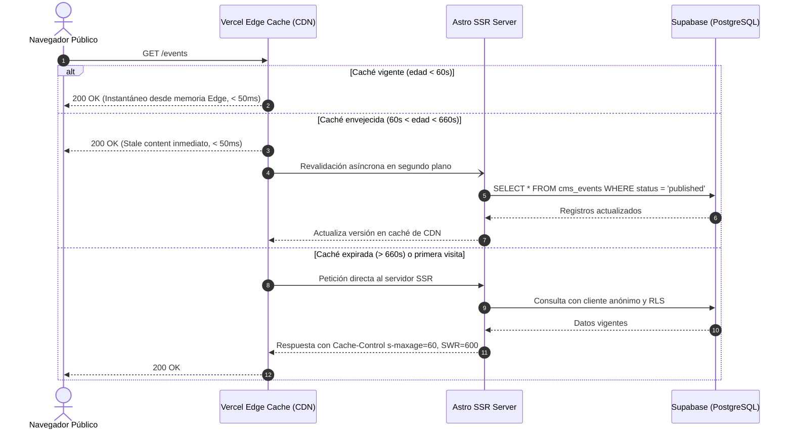

# Especificación de Endpoints (API)

Este documento contiene la especificación técnica de los endpoints de la API local de la plataforma, detallando métodos HTTP, cabeceras, parámetros, payloads de petición, códigos de estado HTTP y ejemplos de respuesta.

---

## 1. `POST /api/apply`

Registra la postulación de un candidato para el proceso de convocatoria actual.

*   **Autenticación**: Ninguna (Acceso público).
*   **Cabeceras Requeridas**:
    *   `Content-Type: application/json`
    *   `X-Requested-With: XMLHttpRequest` (Protección básica CSRF)
*   **Cuerpo de la Petición (JSON)**:
    ```json
    {
      "first_name": "string (obligatorio, máx. 150 caracteres)",
      "last_name": "string (obligatorio, máx. 150 caracteres)",
      "email": "string (obligatorio, formato correo electrónico, máx. 150 caracteres)",
      "phone": "string (obligatorio, exactamente 9 dígitos numéricos)",
      "university": "string (obligatorio, máx. 150 caracteres)",
      "career": "string (obligatorio, máx. 150 caracteres)",
      "university_semester": "string (obligatorio, ciclo académico: '1'-'10' o '0' para egresado)",
      "first_choice_area": "string (obligatorio, área: GTH|ACD|RRPP|DCC|ID)",
      "second_choice_area": "string (opcional, área: GTH|ACD|RRPP|DCC|ID)",
      "application_reason": "string (obligatorio, máx. 2000 caracteres)"
    }
    ```

### Respuestas:
*   **200 OK**: Registro exitoso.
    ```json
    {
      "message": "¡Inscripción recibida correctamente!"
    }
    ```
*   **400 Bad Request**: Datos obligatorios faltantes o con formato/longitud no válida.
    ```json
    {
      "error": "El formato del correo electrónico no es válido."
    }
    ```
*   **403 Forbidden**: Solicitud no iniciada desde el cliente oficial (falta cabecera CSRF).
    ```json
    {
      "error": "Solicitud no autorizada."
    }
    ```
*   **409 Conflict**: Candidato ya registrado (restricción por correo electrónico único).
    ```json
    {
      "error": "Este correo electrónico ya ha sido registrado."
    }
    ```
*   **429 Too Many Requests**: Límite de envíos excedido (máx. 3 por IP en 10 minutos).
    ```json
    {
      "error": "Has enviado demasiadas postulaciones. Intenta de nuevo en unos minutos."
    }
    ```

---

## 2. `POST /api/admin-login`

Autentica al administrador y genera una sesión sin estado.

*   **Autenticación**: Ninguna.
*   **Cabeceras Requeridas**: `Content-Type: application/json`
*   **Cuerpo de la Petición (JSON)**:
    ```json
    {
      "password": "string (obligatorio)"
    }
    ```

### Respuestas:
*   **200 OK**: Credencial correcta. Retorna el token firmado HMAC.
    ```json
    {
      "success": true,
      "token": "payloadBase64.firmaHexadecimal"
    }
    ```
*   **401 Unauthorized**: Contraseña incorrecta. Indica intentos restantes antes del bloqueo.
    ```json
    {
      "error": "Contraseña incorrecta.",
      "attemptsRemaining": 4
    }
    ```
*   **429 Too Many Requests**: Bloqueo activo tras 5 intentos fallidos (bloqueo por 15 minutos).
    ```json
    {
      "error": "Demasiados intentos fallidos. Cuenta bloqueada por 15 minutos.",
      "locked": true,
      "remainingSeconds": 900
    }
    ```

---

## 3. `POST /api/admin-logout`

Invalida la sesión activa en el cliente.

*   **Autenticación**: Requiere token de sesión (opcional en esta capa debido al diseño stateless).
*   **Respuesta**:
    ```json
    {
      "success": true
    }
    ```

---

## 4. `GET /api/admin-applicants`

Retorna la lista de postulantes registrados con opciones de filtrado y ordenamiento.

*   **Autenticación**: Requiere token de sesión en la cabecera.
*   **Cabeceras Requeridas**: `Authorization: Bearer <token>`
*   **Parámetros de Consulta (Query Params)**:
    *   `area` (GTH|ACD|RRPP|DCC|ID) - Filtra por área de interés.
    *   `option` (all|first|second) - Filtra por prioridad de opción seleccionada.
    *   `order` (recent|priority) - Criterio de ordenamiento (por fecha de registro o por prioridad de opción).

### Respuestas:
*   **200 OK**: Retorna el listado estructurado de postulantes.
    ```json
    {
      "data": [
        {
          "id": "550e8400-e29b-41d4-a716-446655440000",
          "first_name": "Pedro",
          "last_name": "Ramos",
          "email": "pedro.ramos@uni.pe",
          "phone": "987654321",
          "university": "UNI",
          "career": "Ingeniería de Sistemas",
          "university_semester": "6",
          "first_choice_area": "ID",
          "second_choice_area": "DCC",
          "application_reason": "Motivación para aprender desarrollo...",
          "created_at": "2026-06-14T21:30:00.000Z"
        }
      ],
      "total": 1
    }
    ```
*   **401 Unauthorized**: Token de sesión ausente, inválido o expirado.
    ```json
    {
      "error": "No autorizado. Inicia sesión nuevamente."
    }
    ```

---

## 5. Arquitectura de Clientes Supabase en Astro SSR

Para garantizar seguridad absoluta, rendimiento y trazabilidad en las operaciones del CMS, la plataforma implementa una separación estricta entre clientes de Supabase según el contexto de ejecución:

| Cliente | Credencial Utilizada | Ámbito de Ejecución | Propósito y Reglas RLS |
| :--- | :--- | :--- | :--- |
| **`supabaseAdmin` (`service_role`)** | `SUPABASE_SERVICE_ROLE_KEY` | **Exclusivamente Servidor** (Endpoints `/api/cms/*`, SSR Frontmatter en rutas administrativas protegidas). | Omite RLS para ejecutar mutaciones validadas por middleware, escribir en `cms_audit_logs`, actualizar `recruitment_config` e interactuar con el bucket `cms-media`. **Estrictamente prohibido exponerlo al cliente.** |
| **Cliente Autenticado (Sesión CMS)** | JWT de usuario autenticado / Cookies HTTP-Only | Servidor (Astro Middleware / `Astro.locals.user`). | Asocia la identidad del usuario (`id`, `email`, `role`, `area_scope`) para validar autorizaciones antes de ejecutar cualquier mutación en el backend. |
| **`supabase` (Cliente Anónimo)** | `PUBLIC_SUPABASE_ANON_KEY` | Servidor (Vistas públicas SSR) y Cliente (Landing pública). | Sujeto a **RLS estricto**: solo permite operaciones `SELECT` sobre registros con estado editorial `status = 'published'`, garantizando que borradores o contenidos en revisión nunca sean accesibles. |

---

## 6. Endpoints Internos del CMS (`/api/cms/*`)

Todos los endpoints administrativos requieren autenticación mediante sesión válida inyectada en cabeceras o cookies seguras, y emiten cabeceras de prevención de caché:
```http
Cache-Control: no-store, no-cache, must-revalidate, proxy-revalidate, max-age=0
Pragma: no-cache
Expires: 0
```

Formato estándar de respuesta exitosa:
```json
{
  "success": true,
  "data": { ... },
  "meta": {
    "timestamp": "2026-11-22T16:00:00.000Z",
    "total": 1,
    "limit": 20,
    "offset": 0
  }
}
```

Formato estándar de respuesta de error:
```json
{
  "success": false,
  "error": {
    "code": "UNAUTHORIZED | FORBIDDEN_AREA | INVALID_STATUS_TRANSITION | NOT_FOUND | CONCURRENCY_CONFLICT | VALIDATION_ERROR",
    "message": "Mensaje legible para el usuario o interfaz.",
    "details": null
  },
  "meta": {
    "timestamp": "2026-11-22T16:00:00.000Z"
  }
}
```

---

### 6.1. `GET /api/cms/events`
Retorna el listado paginado de eventos del CMS con filtros administrativos y editoriales.

*   **Autenticación**: Obligatoria (`admin`, `approver`, `editor`).
*   **Parámetros de Consulta (Query Params)**:
    *   `status` *(opcional)*: `draft` | `pending_review` | `published` | `archived`.
    *   `eventType` *(opcional)*: `upcoming` | `completed`.
    *   `areaScope` *(opcional)*: `ID` | `RRPP` | `GTH` | `ACD` | `DCC` | `LGE` | `FIN`. Si el usuario no es `admin`, queda forzado a su propio `area_scope`.
    *   `search` *(opcional)*: Búsqueda por coincidencia de texto en título, ponente o descripción.
    *   `limit` *(opcional, default: 20)*: Cantidad de registros por página.
    *   `offset` *(opcional, default: 0)*: Desplazamiento para paginación.
*   **Respuesta 200 OK**:
    ```json
    {
      "success": true,
      "data": [
        {
          "id": "e3b0c442-98fc-1c14-9afb-4c2dd84f3c95",
          "title": "Software Week 2026",
          "slug": "software-week-2026",
          "eventType": "upcoming",
          "status": "published",
          "date": "2026-09-01T09:00:00.000Z",
          "time": "09:00 AM – 05:00 PM",
          "location": "Auditorio FIIS - UNI",
          "areaScope": "DCC",
          "image": "cms-media/events/software-week-banner.webp",
          "publishedAt": "2026-08-20T14:30:00.000Z"
        }
      ],
      "meta": { "total": 12, "limit": 20, "offset": 0, "timestamp": "2026-11-22T16:00:00.000Z" }
    }
    ```

---

### 6.2. `POST /api/cms/events`
Crea un nuevo evento en estado `draft` (borrador).

*   **Autenticación**: Obligatoria (`admin` o `editor`/`approver` del área).
*   **Cabeceras Requeridas**: `Content-Type: application/json`
*   **Cuerpo de la Petición (JSON)**:
    ```json
    {
      "title": "Taller de Introducción a Supabase",
      "slug": "taller-introduccion-supabase",
      "description": "Sesión práctica sobre diseño relacional y RLS en PostgreSQL.",
      "shortDescription": "Aprende Supabase desde cero con el equipo de ID.",
      "eventType": "upcoming",
      "date": "2026-12-05T15:00:00.000Z",
      "time": "03:00 PM – 05:00 PM",
      "location": "Virtual (Google Meet)",
      "category": "Desarrollo",
      "image": "cms-media/events/supabase-workshop.webp",
      "registrationUrl": "https://luma.com/unicode-supabase",
      "areaScope": "ID",
      "speakers": [
        { "name": "Alejandro Velarde", "role": "Líder de Desarrollo" }
      ]
    }
    ```
*   **Respuesta 201 Created**: Retorna el registro del evento creado con estado `draft`.

---

### 6.3. `GET /api/cms/events/:id`
Obtiene los metadatos completos de un evento específico por su identificador UUID.

*   **Autenticación**: Obligatoria.
*   **Respuestas**:
    *   **200 OK**: Retorna la entidad `CmsEvent`.
    *   **404 Not Found**: Evento inexistente o sin permiso de lectura por `area_scope`.

---

### 6.4. `PUT /api/cms/events/:id`
Actualiza la información de un evento existente. Solo se permiten modificaciones sobre eventos en estado `draft` o `pending_review` (para eventos en `published`, una edición mayor requiere volver a `draft` o validación por aprobador).

*   **Autenticación**: Obligatoria (Requiere que el `area_scope` del usuario coincida con el del evento o que el rol sea `admin`).
*   **Cuerpo de la Petición (JSON)**: Payload parcial con los campos a modificar.
*   **Respuesta 200 OK**: Retorna el registro actualizado.

---

### 6.5. `POST /api/cms/events/:id/transition`
Ejecuta una transición formal en el ciclo de vida editorial del evento.

*   **Autenticación**:
    *   Transición a `pending_review`: `editor`, `approver` o `admin`.
    *   Transición a `published` o `archived`: Exclusivamente `approver` (director del área) o `admin`.
*   **Cuerpo de la Petición (JSON)**:
    ```json
    {
      "targetStatus": "published",
      "reason": "Contenido, enlaces de registro y banner validados por Dirección."
    }
    ```
*   **Efectos Secundarios**:
    *   Verifica que la transición esté en la matriz `CMS_ALLOWED_STATUS_TRANSITIONS`.
    *   Registra una entrada en `cms_audit_logs` con `action: 'publish'`, `actorId`, `beforeValue` y `afterValue`.
    *   Si el nuevo estado es `published`, actualiza `published_at = now()`.
*   **Respuestas**:
    *   **200 OK**: Transición ejecutada con éxito.
    *   **400 Bad Request**: Transición no permitida según el ciclo de vida (ej. pasar de `draft` directo a `published` sin revisión).
    *   **403 Forbidden**: El rol del usuario no tiene privilegios de publicación (`canPublish = false`).

---

### 6.6. `DELETE /api/cms/events/:id`
Archiva o elimina un evento del CMS.

*   **Autenticación**: Exclusivamente `admin` o `approver`.
*   **Comportamiento**:
    *   Por defecto aplica **archivado lógico** (`status = 'archived'`).
    *   Si se proporciona el query param `?permanent=true` (solo para `admin`), ejecuta el borrado físico (`DELETE`) eliminando también sus archivos asociados en el bucket de Storage.
*   **Respuesta 200 OK**: Confirma el archivado o la eliminación.

---

### 6.7. `GET /api/cms/call-config`
Obtiene los parámetros públicos de la vista `/call` desde `recruitment_config.settings`.

*   **Autenticación**: Obligatoria (`admin` o `area_scope: 'GTH'`).
*   **Respuesta 200 OK**:
    ```json
    {
      "success": true,
      "data": {
        "revision": 4,
        "settings": {
          "enabled": true,
          "title": "Convocatoria 2026-II",
          "opensAt": "2026-08-01T00:00:00-05:00",
          "closesAt": "2026-08-31T23:59:59-05:00",
          "scheduleStages": [
            { "id": "stage-1", "title": "Inscripciones", "status": "completed", "order": 1 },
            { "id": "stage-2", "title": "Entrevistas", "status": "active", "order": 2 }
          ],
          "areaRequirements": [
            { "areaId": "ID", "name": "Investigación y Desarrollo", "requirements": ["..."], "enabled": true }
          ]
        }
      }
    }
    ```

---

### 6.8. `PUT /api/cms/call-config`
Actualiza atómicamente los parámetros públicos de Convocatoria con control de concurrencia optimista y auditoría.

*   **Autenticación**: Exclusivamente `admin` o Director de `GTH`.
*   **Cabeceras Requeridas**: `Content-Type: application/json`
*   **Cuerpo de la Petición (JSON)**:
    ```json
    {
      "expectedRevision": 4,
      "settings": {
        "enabled": false,
        "closesAt": "2026-09-05T23:59:59-05:00"
      },
      "reason": "Cierre de recepción de postulaciones por límite de capacidad alcanzado."
    }
    ```
*   **Protocolo de Ejecución**:
    1. Verifica que la revisión actual en base de datos coincida con `expectedRevision`. Si no coincide, rechaza con `409 Conflict`.
    2. Aplica la mutación, incrementando atómicamente `revision = revision + 1`.
    3. Registra el evento en `recruitment_config_events` con el diferencial del cambio y la justificación.
*   **Respuestas**:
    *   **200 OK**: Parámetros actualizados exitosamente con la nueva revisión.
    *   **409 Conflict**: Conflicto de edición concurrente (`CONCURRENCY_CONFLICT`). El cliente debe recargar los datos antes de reintentar.

---

### 6.9. `POST /api/cms/media/upload`
Genera una URL firmada o sube directamente un archivo multimedia al bucket `cms-media` de Supabase Storage.

*   **Autenticación**: Obligatoria.
*   **Restricciones**:
    *   Formatos permitidos: WebP, PNG, JPG, SVG.
    *   Tamaño máximo: 3 MB por imagen.
*   **Cuerpo de la Petición**: `multipart/form-data` con campo `file` y carpeta destino (`events/`, `call/`, `alliances/`).
*   **Respuesta 200 OK**:
    ```json
    {
      "success": true,
      "data": {
        "path": "events/software-week-banner.webp",
        "publicUrl": "https://<supabase-project>.supabase.co/storage/v1/object/public/cms-media/events/software-week-banner.webp"
      }
    }
    ```

---

## 7. Estrategia de Caché SWR e Invalidación

Para resolver la disyuntiva entre **LCP < 2.5s** e **inmediatez de publicación**, el sistema implementa la arquitectura Stale-While-Revalidate en capa de CDN (Vercel Edge / Cloudflare):



### Invalidación Bajo Demanda tras Mutaciones
Cuando un aprobador publica un evento en `/api/cms/events/:id/transition` o actualiza la convocatoria en `/api/cms/call-config`:
1. El servidor procesa la mutación en Supabase.
2. Emite una purga de caché por etiqueta (**Cache-Tag**):
   * `cms:events` al publicar/archivar eventos.
   * `cms:call-config` al alterar parámetros de convocatoria.
3. La siguiente solicitud pública a `/events` o `/call` recibe el contenido recién publicado sin esperar a que transcurran los 60 segundos del ciclo ordinario.

---

## 8. Estrategia de Resiliencia, Fallback y Gestión de Errores

Para garantizar que la web pública de UNICODE nunca exponga pantallas de error 500 ante contingencias externas:

### 8.1. Degradación Elegante en Tiempo de Ejecución
Si el servicio de base de datos de Supabase experimenta latencia extrema, límite de conexiones o indisponibilidad temporal:
1. La consulta SSR envuelta con `withFallback()` captura la excepción sin propagar el fallo al servidor HTTP.
2. Se registra una advertencia en el log del servidor (`[CMS Fallback] Operación falló. Usando datos de respaldo.`).
3. Se inyecta la colección estática de respaldo (`getEventsFallback()` o `getCallConfigFallback()`), permitiendo que el visitante visualice la cartelera base de eventos o la información general de convocatoria con status HTTP 200.

### 8.2. Catálogo de Códigos de Error Estandarizados

| Código de Error | HTTP Status | Causa Típica | Acción Recomendada para el Cliente |
| :--- | :---: | :--- | :--- |
| `UNAUTHORIZED` | 401 | Sesión inexistente o token JWT expirado. | Redirigir a `/admin/login`. |
| `FORBIDDEN_AREA` | 403 | El usuario intenta editar o publicar contenido de un área fuera de su `area_scope`. | Mostrar advertencia de permisos insuficientes. |
| `INVALID_STATUS_TRANSITION` | 400 | Intento de saltarse el flujo editorial (ej. pasar de `draft` directo a `published`). | Guiar al editor a pasar por `pending_review`. |
| `NOT_FOUND` | 404 | El recurso solicitado no existe en base de datos. | Mostrar estado vacío o notificar que el registro fue retirado. |
| `CONCURRENCY_CONFLICT` | 409 | `expectedRevision` en Convocatoria no coincide con la versión en base de datos. | Recargar configuración más reciente y reintentar. |
| `VALIDATION_ERROR` | 422 | Payload con campos obligatorios ausentes o tipos de datos no válidos. | Resaltar los campos defectuosos en el formulario. |
| `STORAGE_ERROR` | 502 | Fallo en la subida o firma del bucket de Supabase Storage. | Solicitar reintentar la subida o verificar peso de imagen (< 3MB). |
| `INTERNAL_ERROR` | 500 | Error no previsto en capa de servidor. | Reportar al equipo de ID con código de rastreo. |

