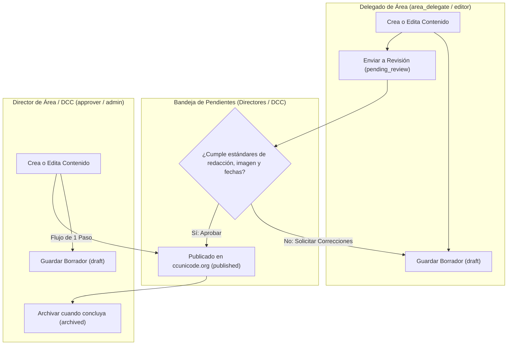

# Documentación del Frontend

Este documento describe la arquitectura, las guías de desarrollo, los contratos de datos, las especificaciones de diseño aplicados en el frontend de la plataforma oficial de UNICODE y la especificación de wireframes de alta fidelidad del panel CMS (**CMS-3**).

### Índice Rápido
1. [Explicación (Contexto y Arquitectura)](#1-explicación-contexto-y-arquitectura)
2. [Guías Prácticas (Consumo de APIs y Modales)](#2-guías-prácticas-instrucciones-orientadas-a-tareas)
3. [Referencia (Estructura, Rutas y Tokens)](#3-referencia-especificaciones-técnicas-y-contratos)
4. [Tutorial (Añadir un Área de Conocimiento)](#4-tutorial-instrucciones-de-aprendizaje)
5. [Especificación UI/UX del Panel Administrativo CMS (CMS-3)](#5-especificación-uiux-del-panel-administrativo-cms-cms-3)
   - [5.1. Sistema de Diseño Visual y Paleta Oficial](#51-sistema-de-diseño-visual-y-paleta-oficial-tema-oscuro--verde-neón)
   - [5.2. Wireframes de Alta Fidelidad (Login, Sidebar, Eventos, Convocatoria)](#52-wireframes-de-alta-fidelidad)
   - [5.3. Matriz de Permisos y Flujos Editoriales: 1 Paso vs 2 Pasos](#53-matriz-de-permisos-y-flujos-editoriales-1-paso-vs-2-pasos)
   - [5.4. Especificación Visual de Badges de Estado Editorial](#54-especificación-visual-de-badges-de-estado-editorial)
   - [5.5. Catálogo de Componentes UI Reutilizables del CMS](#55-catálogo-de-componentes-ui-reutilizables-del-cms)

---

## 1. Explicación (Contexto y Arquitectura)

Esta sección provee el contexto técnico, las herramientas utilizadas y los fundamentos arquitectónicos que justifican el diseño actual del cliente.

### 1.1. Arquitectura de Islas
El frontend está construido sobre el framework Astro. Por defecto, Astro compila el código del lado del servidor y envía HTML estático libre de JavaScript al navegador. La interactividad del lado del cliente se logra mediante la hidratación selectiva de componentes dinámicos únicamente cuando es estrictamente necesario (por ejemplo, el panel de administración o el modal de postulación), manteniendo un peso de página mínimo y un rendimiento de carga óptimo.

### 1.2. Ecosistema Tecnológico y Distribución de Trabajo

#### 1.2.1. Componentes del Stack Tecnológico
Cada tecnología del entorno del cliente ha sido seleccionada para cumplir con los requisitos de rendimiento, tipado estricto y modularidad exigidos por la Directiva ID:

* **Astro Framework (v4.x):** Actúa como el orquestador principal de la interfaz de usuario. Utiliza la arquitectura de islas para compilar estáticamente las vistas principales en el servidor, inyectando código JavaScript hidratado únicamente en las secciones interactivas que lo requieran para agilizar el tiempo de carga (LCP).
* **TypeScript:** Implementa un entorno de tipado estricto en el lado del cliente. Asegura que los contratos de datos de la capa API local y las propiedades transferidas a los componentes coincidan estrictamente con las interfaces de control, previniendo excepciones en tiempo de ejecución.
* **Tailwind CSS:** Framework utilitario que agiliza la maquetación bajo el enfoque orientado a móviles corporativo. Centraliza la paleta de colores del tema oscuro dominante y restringe las interacciones y llamados a la acción (CTAs) al color de acento verde neón institucional (`#75D32D`).
* **State Store (`lib/session-store.ts` & client-side storage):** El estado de la sesión administrativa se gestiona a nivel de cliente usando `sessionStorage` y se valida criptográficamente en el servidor mediante el módulo de sesión de Edge, eliminando la necesidad de dependencias reactivas masivas.

#### 1.2.2. Distribución de Módulos por Ramas
Para evitar colisiones en el control de versiones y garantizar la autonomía del desarrollo, el sistema se divide de manera modular en cuatro flujos asignados por áreas de trabajo:

* **Módulo de Convocatorias y Página de Inicio:** Contiene la lógica del formulario de postulación y los componentes interactivos de la landing page principal.
* **Módulo de Áreas de Conocimiento:** Responsable de la arquitectura y subrutas físicas individuales de las disciplinas organizacionales en `src/pages/areas/`. Coordina la inyección de estilos activos para mantener la retroalimentación de las pestañas seleccionadas, gestiona los componentes de esqueleto de carga visual (*Skeleton Loaders*) y centraliza los mocks de datos estáticos en `src/data/projects.ts`.
* **Módulo de Catálogo de Proyectos:** Contiene el catálogo de soluciones tecnológicas desarrolladas por el centro, incluyendo filtros avanzados y fichas técnicas.
* **Módulo de Agenda y Calendario de Eventos:** Encargado de la visualización cronológica de actividades e historial de eventos del centro.

### 1.3. Flujo de Datos y Capa de API Intermedia
Para interactuar de forma segura con la base de datos de Supabase, la aplicación implementa una capa intermedia de endpoints locales en el directorio `src/pages/api/`. En lugar de inicializar clientes de administración con privilegios elevados en el navegador, el cliente del frontend realiza consultas HTTPS directas a estos endpoints locales. Este enfoque previene la exposición de claves privadas del servidor (como `SUPABASE_SERVICE_ROLE_KEY`) y permite centralizar la validación de tokens de sesión y el control de tasas de solicitudes en el servidor.

### 1.4. Enfoque de Diseño Visual (UI/UX)
La interfaz del proyecto adopta el concepto de diseño orientado a móviles, lo que asegura que todos los flujos de usuario y diseños se estructuren primero para pantallas de dispositivos móviles antes de escalarse a resoluciones de tableta y escritorio. La estética visual se basa en un tema oscuro dominante para reducir la fatiga visual, utilizando contrastes de gris oscuro y negro junto con el color de acento verde neón (`#75D32D`) para destacar elementos de acción primaria (CTAs), enlaces activos y estados de interacción.

---

## 2. Guías Prácticas (Instrucciones orientadas a tareas)

Estas guías proporcionan procedimientos específicos para resolver tareas de desarrollo recurrentes en el cliente sin duplicar lógica de código en la documentación.

### 2.1. Cómo consumir APIs internas y controlar los estados de la UI
Para consultar datos de los endpoints del backend e integrar los diferentes estados de la interfaz de usuario en el cliente, siga el flujo conceptual estructurado a continuación:

1.  **Fase de Carga**: Al iniciar la acción asíncrona, oculte el contenedor principal de la lista de datos y los contenedores de mensaje de error o estado vacío. Active e inserte visualmente en el DOM el componente indicador de carga (como un spinner de carga o un esqueleto de carga de ancho adaptativo).
2.  **Fase de Consumo Asíncrono**: Realice una llamada HTTPS asíncrona (utilizando `fetch` con `async/await`) al endpoint local correspondiente dentro de `src/pages/api/`. Si el endpoint requiere privilegios de administrador, extraiga el token de sesión guardado en el almacenamiento local e inyéctelo en la cabecera `Authorization` bajo el esquema de portador (`Bearer`).
3.  **Fase de Evaluación / Estado Vacío**: Una vez obtenida la respuesta exitosa del servidor, verifique la longitud del arreglo de datos recibido. Si el total de elementos es igual a cero, oculte el componente indicador de carga y active la visibilidad del contenedor de estado vacío para informar al usuario de la ausencia de registros.
4.  **Fase de Error con Captura**: Envuelva todo el procedimiento en un bloque de control `try/catch`. Si la petición falla por problemas de red, si el servidor responde con códigos de error (4xx/5xx) o si el token de sesión es inválido, capture la excepción en el bloque `catch`, oculte el indicador de carga, muestre un mensaje descriptivo en el contenedor de error y proporcione un botón de reintento que invoque nuevamente la función de carga.

### 2.2. Cómo controlar la apertura y cierre de diálogos modales
Para implementar y controlar ventanas emergentes en el navegador sin interferir con la navegación del usuario de fondo, utilice el elemento de diálogo nativo:

1.  **Estructura del Componente**: Declare la ventana de diálogo utilizando la etiqueta nativa `<dialog>` en el archivo del componente.
2.  **Apertura del Diálogo**: En el script del cliente, capture el evento de clic de los botones de activación e invoque el método nativo `.showModal()` del elemento de diálogo. Esto asegura la gestión automática del foco de teclado y el renderizado correcto del fondo traslúcido.
3.  **Cierre del Diálogo**: Capture el evento de clic en el botón de cierre del formulario e invoque el método nativo `.close()` del elemento de diálogo.
4.  **Bloqueo de Desplazamiento**: Para evitar que el usuario pueda desplazarse por el contenido de la página principal mientras el modal está abierto, asigne el valor `"hidden"` a la propiedad `document.body.style.overflow` durante la apertura, y restablézcalo a `"auto"` al ejecutar el cierre.

---

## 3. Referencia (Especificaciones técnicas y contratos)

Esta sección contiene datos concretos, contratos de interfaces y especificaciones técnicas para consulta rápida.

### 3.1. Estructura de Directorios del Frontend (`src/`)
A continuación se detalla la organización modular de las carpetas principales del cliente:

```text
src/
├── assets/                             # Recursos estáticos (Imágenes y logotipos)
├── components/                         # Componentes globales y modulares (Astro)
│   ├── components-areas/               # Módulos del flujo de áreas de conocimiento
│   ├── components-call/                # Componentes para el flujo de convocatorias
│   ├── components-events/              # Componentes para el calendario y agenda
│   ├── components-home/                # Elementos exclusivos de la Landing principal
│   └── components-projects/            # Componentes del catálogo de proyectos
├── data/                               # Datos estáticos y mocks estructurados
├── layouts/                            # Estructuras base de página compartidas
├── lib/                                # Librerías, utilidades y clientes de persistencia
├── styles/                             # Directivas globales de diseño (Tailwind CSS)
├── types/                              # Tipos estáticos y definiciones TypeScript
└── pages/                              # Enrutamiento basado en archivos físicos y endpoints locales
```

### 3.2. Enrutamiento y Páginas Físicas
La aplicación utiliza enrutamiento basado en archivos físicos dentro del directorio `src/pages/`:

*   `/` -> Página de inicio (`index.astro`).
*   `/areas` -> Catálogo maestro de áreas (`areas.astro`).
*   `/areas/academic` -> Detalle del área Académica (`areas/academic.astro`).
*   `/areas/communication-and-content` -> Detalle de DCC (`areas/communication-and-content.astro`).
*   `/areas/talent-management` -> Detalle de GTH (`areas/talent-management.astro`).
*   `/areas/research-and-development` -> Detalle de I+D (`areas/research-and-development.astro`).
*   `/areas/public-relations` -> Detalle de RRPP (`areas/public-relations.astro`).
*   `/call` -> Formulario de inscripción y convocatoria activa (`call.astro`).
*   `/events` -> Agenda e historial de actividades del centro (`events.astro`).
*   `/projects` -> Repositorio visual y vitrina de proyectos (`projects.astro`).
*   `/admin` -> Panel de administración y dashboard de postulantes (`admin.astro`).

### 3.3. Contratos de la API (Endpoints en `src/pages/api/`)
Para consultar los detalles formales de los contratos JSON de petición, parámetros de consulta, códigos de respuesta HTTP y ejemplos para cada uno de los endpoints de la plataforma (`/api/apply`, `/api/admin-login`, `/api/admin-logout`, `/api/admin-applicants`), consulte la documentación unificada en:
*   [Especificación de Endpoints (API)](endpoints.md)

### 3.4. Tokens de Diseño y Accesibilidad
*   **Colores de la Paleta de Tailwind**:
    *   Fondo general: `#050505` (Neutral oscuro oscuro) / `#0a0a0a` (Neutral oscuro secundario).
    *   Líneas y bordes: `#27272a` (zinc-800) / `#3f3f46` (zinc-700).
    *   Acento primario y texto resaltado: `#75D32D` (Verde Neón UNICODE).
*   **Breakpoints Responsivos**:
    *   Móvil: `320px` a `480px` (Vista por defecto).
    *   Tableta: `481px` a `1024px` (Escalamiento en cuadrícula).
    *   Escritorio: `1025px` o superior (Menús laterales, vistas de ancho completo).
*   **Criterios de Accesibilidad**:
    *   Uso estricto de la etiqueta `<label>` con el atributo `for` enlazado al `id` del campo correspondiente en todos los formularios.
    *   Atributos `aria-label` descriptivos aplicados a todos los botones que contienen únicamente iconos (por ejemplo, flechas de paginación o botones de cierre).
    *   Contraste de color superior a 4.5:1 en textos de lectura general y títulos primarios.

### 3.5. Distribución de Módulos
El desarrollo de la plataforma se encuentra estructurado en base a la distribución de módulos individuales coordinados:

*   **Sección Home y Sección Convocatoria:** Responsable de la lógica de negocio, control de estados del formulario y validaciones seguras del cliente conectadas a Supabase.
*   **Sección Áreas:** Responsable de la estructura modular de las disciplinas de I+D (ID), Relaciones Públicas (RRPP), Gestión del Talento Humano (GTH), Académica (ACD) y Dirección de Creación y Contenido (DCC).
*   **Sección Proyectos:** Responsable de la maquetación de tarjetas, vistas y filtros avanzados de los proyectos desarrollados por el centro.
*   **Sección Eventos:** Responsable del diseño y visualización cronológica de actividades e historial de eventos de las áreas.

### 3.6. Arquitectura y Especificación Técnica de las Secciones

#### 3.6.1. Home
Esta sección detalla la arquitectura modular y los patrones implementados para la página de inicio (Landing Page) de UNICODE:

1.  **Componentes Modulares Asociados (`src/components/components-home/` y `src/components/`)**:
    *   `Hero.astro`: Panel principal que presenta la propuesta de valor con un diseño inmersivo de fondo SVG y el color de acento institucional verde neón.
    *   `Stats.astro`: Componente que muestra de forma numérica los logros y métricas de impacto de la organización.
    *   `news.astro` y `news-card.astro`: Grilla responsiva y tarjeta individual para renderizar noticias y actualizaciones del centro.
    *   `us.astro`: Detalle conceptual de la misión, visión y objetivos organizacionales de UNICODE.
    *   `alliances.astro`: Módulo que renderiza logotipos responsivos de organizaciones y comunidades asociadas.
    *   `explore-unicode.astro`: Panel de navegación interactivo con enlaces a los diferentes módulos de la plataforma.
    *   `presidents.astro`: Sección para destacar el equipo de liderazgo y directiva del centro.
2.  **Sistema de Enrutamiento y Generación**:
    La Landing Page de inicio se gestiona mediante la ruta raíz `/` mapeada al archivo `src/pages/index.astro`, compilada del lado del servidor para garantizar el máximo rendimiento de carga (LCP) y SEO.

#### 3.6.2. Áreas
Esta sección detalla la arquitectura modular y los patrones implementados para la gestión de las disciplinas de UNICODE:

1.  **Componentes Modulares Asociados (`src/components/components-areas/`)**:
    *   `area-card.astro`: Renderiza la presentación resumida y acceso individual de la disciplina en la grilla general del catálogo.
    *   `hero-area-individual.astro`: Encabezado responsivo personalizado para cada disciplina, importando metadatos particulares.
    *   `area-director-profile.astro`: Estructura visual para renderizar la foto, biografía corta y rol del director del área correspondiente.
    *   `area-valor.astro` y `area-win-card.astro`: Bloques dinámicos diseñados para renderizar los pilares y logros específicos del área de conocimiento.
    *   `area-project-card.astro` y `area-project-slider.astro`: Carrusel responsivo que filtra y muestra exclusivamente los proyectos de desarrollo tecnológico del área seleccionada.
    *   `area-requirement.astro`: Bloque informativo que lista de forma declarativa los perfiles técnicos y requerimientos mínimos exigidos a los postulantes.
2.  **Sistema de Enrutamiento y Generación**:
    Las rutas de las disciplinas se gestionan a través de archivos estáticos individuales bajo el directorio `src/pages/areas/` (ej. `academic.astro`, `talent-management.astro`), garantizando compatibilidad total con renderizado SSR y posicionamiento en buscadores (SEO) sin dependencias de enrutamiento dinámico en el navegador.
3.  **Integración de Estado e Interactividad**:
    El control de la navegación interactiva y la retención de filtros por disciplina en la interfaz del cliente se delega a la manipulación directa del DOM mediante scripts de vanilla JavaScript optimizados. Esto mantiene el consumo de memoria en niveles mínimos y desacopla los componentes de dependencias de frameworks reactivos de terceros.

#### 3.6.3. Proyectos
Esta sección detalla la arquitectura modular y los patrones implementados para la vitrina de soluciones tecnológicas de UNICODE:

1.  **Componentes Modulares Asociados (`src/components/components-projects/`)**:
    *   `project-hero.astro`: Encabezado visual de la sección con un título estilizado y una breve descripción introductoria.
    *   `featured-section.astro` y `featured-project-card.astro`: Bloques diseñados para destacar proyectos especiales de ancho completo, incluyendo detalles de la solución y botones interactivos.
    *   `project-filters.astro`: Panel interactivo que provee un campo de búsqueda de texto en tiempo real y un selector de filtros para segmentar por área organizativa.
    *   `project-grid.astro` y `project-card.astro`: Grilla responsiva y tarjeta individual para mostrar la vista previa de cada proyecto activo (imagen, etiquetas, título y descripción).
    *   `project-modal.astro`: Diálogo modal nativo que renderiza la ficha técnica detallada del proyecto seleccionado, incluyendo capturas de pantalla, tecnologías, repositorio, sitio web y miembros del equipo.
    *   `project-slider.astro`: Carrusel interactivo y responsivo para proyectos de código abierto (*open source*).
2.  **Sistema de Enrutamiento y Generación**:
    La vista principal se gestiona a través de la ruta física `/projects` mapeada al archivo `src/pages/projects.astro`, el cual aprovecha el renderizado en el servidor (SSR) para obtener los proyectos del archivo de datos estáticos y renderizar el contenido inicial.
3.  **Integración de Estado Reactivo e Interactividad**:
    La interactividad del catálogo (filtrado en tiempo real, búsqueda de texto, paginado y control del modal detallado) se ejecuta mediante scripts vanilla en el cliente. La paginación en pantallas de escritorio muestra hasta 6 elementos por página y se adapta dinámicamente, mientras que en pantallas móviles se muestra la lista completa de manera fluida.

#### 3.6.4. Eventos
Esta sección detalla la arquitectura modular y los patrones implementados para el cronograma y FAQ de actividades:

1.  **Componentes Modulares Asociados (`src/components/components-events/`)**:
    *   `hero-events.astro`: Banner introductorio de la sección que expone el título de la agenda.
    *   `upcoming-events.astro`: Panel que expone los eventos activos y calendarizados a futuro mediante tarjetas interactivas.
    *   `completed-events.astro`: Galería estructurada de actividades previas que han concluido con éxito.
    *   `faq-events.astro`: Sección de preguntas frecuentes con un diseño de acordeón interactivo estilizado.
2.  **Sistema de Enrutamiento y Generación**:
    La sección de eventos se mapea a la ruta física `/events` gestionada por el archivo `src/pages/events.astro`. Obtiene los registros dinámicos del mock estático ubicado en `src/data/events.ts`.
3.  **Interactividad y Control del DOM**:
    Los efectos del acordeón para las FAQ de eventos y la navegación fluida a través de las actividades se implementan utilizando lógica nativa de JavaScript (Vanilla JS) en el cliente.

#### 3.6.5. Convocatoria
Esta sección detalla la arquitectura modular, integraciones y flujos funcionales del proceso de postulación a UNICODE:

1.  **Componentes Modulares Asociados (`src/components/components-call/`)**:
    *   `hero-call.astro`: Encabezado visual diseñado para incentivar el registro de candidatos durante el periodo activo.
    *   `why-unicode.astro`: Módulo que destaca las ventajas y beneficios de ser miembro activo del centro.
    *   `register-modal.astro`: Componente crítico e interactivo de diálogo modal (utilizando el elemento nativo `<dialog>`) que encapsula el formulario de postulación del candidato.
2.  **Sistema de Enrutamiento y Generación**:
    El flujo de registro reside en la ruta `/call` gestionada por el archivo `src/pages/call.astro`. Su visibilidad depende del estado lógico global configurado en el archivo `src/data/siteConfig.ts` (`CONVOCATORIA_ABIERTA`).
3.  **Flujo de Integración Asíncrona con el Backend**:
    *   **Control de Apertura y Cierre:** Se inyectan controladores en el cliente para interceptar enlaces con el ancla `#postular`. Al hacer clic, se invoca `.showModal()` y se bloquea el desplazamiento del cuerpo de la página (`overflow: hidden`).
    *   **Consumo de la API de Registro:** El envío del formulario se intercepta asíncronamente mediante un evento `submit` en el cliente. Los datos del formulario se envían mediante una petición `POST` al endpoint `/api/apply`.
    *   **Gestión de Respuestas y Errores:** Al iniciar la llamada, se desactiva el botón de envío y se muestra un spinner visual. En caso de respuesta exitosa (200 OK), se muestra un mensaje en color verde neón y el modal se cierra automáticamente tras 2.5 segundos. Ante cualquier fallo del servidor (400/500) o problema de red, el bloque `catch` inhabilita la carga y renderiza una alerta en color rojo neón que orienta al usuario para un reintento seguro.

---

## 4. Tutorial (Instrucciones de aprendizaje)

Este tutorial enseña a añadir un área de conocimiento adicional a la Landing Page paso a paso.

### Requisitos Previos
*   Contar con un entorno de desarrollo local activo corriendo con `npm run dev`.
*   Tener acceso al archivo del modal de registro y el panel de administración.

### Paso 1: Registrar el código del área en el Modal de Inscripción
Abra el archivo `src/components/components-call/register-modal.astro`. Busque el selector de `first_choice_area` e inyecte una nueva etiqueta `<option>` con la abreviatura de tres letras en inglés del área que va a crear:

```html
<!-- Ejemplo para añadir un área ficticia 'TI' -->
<option value="TI">Tecnologías de la Información (TI)</option>
```

Repita la inserción de la opción en el selector correspondiente a `second_choice_area` dentro del mismo archivo para permitir su selección secundaria.

### Paso 2: Registrar la pestaña en el Panel de Administración
Abra el archivo `src/pages/admin.astro`. Inserte un botón para la pestaña del área dentro de la sección de filtros por área:

```html
<button
  class="area-tab px-3 sm:px-5 py-1.5 sm:py-2 rounded-full text-xs sm:text-sm font-semibold transition-all duration-200"
  data-area="TI"
>
  Área TI
</button>
```

Localice la constante `areaNames` en la etiqueta de script de `admin.astro` e inyecte la traducción para que el dashboard muestre el título formateado correctamente al seleccionarse la pestaña:

```typescript
const areaNames: Record<string, string> = {
  GTH: "Área de GTH",
  ACD: "Área Académica",
  ID: "Área de ID",
  RRPP: "Área RRPP",
  DCC: "Área DCC",
  TI: "Área de TI", // Nueva área agregada
};
```

### Paso 3: Crear la página de detalles del área en la estructura de rutas
Cree un archivo físico bajo el directorio `src/pages/areas/` siguiendo el formato kebab-case en minúsculas y sin acentos. Por ejemplo: `src/pages/areas/information-technologies.astro`.

Maquete el archivo heredando la plantilla maestra e importando los componentes correspondientes:

```astro
---
import Layout from "../../layouts/Layout.astro";
import Navbar from "../../components/navbar.astro";
import HeroAreaIndividual from "../../components/components-areas/hero-area-individual.astro";
import AreaDirectorProfile from "../../components/components-areas/area-director-profile.astro";
---

<Layout title="Tecnologías de la Información - UNICODE">
  <Navbar />
  <main class="min-h-screen bg-[#050505] pt-24 text-white">
    <HeroAreaIndividual 
      title="Tecnologías de la Información"
      description="Dirección encargada del soporte tecnológico de nuestra organización."
    />
    
    <div class="max-w-7xl mx-auto px-6 py-12">
      <AreaDirectorProfile 
        name="John Doe"
        role="Director de TI"
        bio="Estudiante de Ingeniería de Software apasionado por la infraestructura."
      />
    </div>
  </main>
</Layout>
```

### Paso 4: Validar el despliegue local
Abra el navegador en `http://localhost:4321/areas/information-technologies` y compruebe que la página renderice el tema oscuro con el color de acento correcto. Compruebe la apertura del modal y la presencia del nuevo campo de selección.

---

## 5. Especificación UI/UX del Panel Administrativo CMS (CMS-3)

Esta sección define la arquitectura de interfaz de usuario, los wireframes de alta fidelidad, el sistema de permisos editoriales y el catálogo de componentes reutilizables para el nuevo Panel Administrativo CMS de UNICODE, dando cumplimiento a los criterios de aceptación de **CMS-3**.

### 5.1. Sistema de Diseño Visual y Paleta Oficial (Tema Oscuro + Verde Neón)

El CMS respeta de manera estricta la guía visual institucional de UNICODE:

*   **Fondo General de la Aplicación:** `#050505` (`bg-[#050505]`).
*   **Superficie de Tarjetas y Sidebar:** `#0F0F0F` / `#121212` (`bg-[#0F0F0F]`, `bg-[#121212]`).
*   **Bordes y Separadores:** `#27272a` (`border-zinc-800`), con transiciones a `#3f3f46` (`hover:border-zinc-700`).
*   **Color de Acento Primario (Verde Neón):** `#75D32D` (`text-unicode`, `bg-unicode`, `border-unicode`).
*   **Brillo y Énfasis Glow:** `shadow-[0_0_20px_rgba(117,211,45,0.25)]` (`shadow-unicode`).
*   **Texto Principal:** `#FFFFFF` (`text-white`) con tipografía sans-serif semibold / bold.
*   **Texto Secundario:** `#A1A1AA` (`text-zinc-400`) y `#71717A` (`text-zinc-500`).

---

### 5.2. Wireframes de Alta Fidelidad

#### 5.2.1. Login Administrativo (`/admin/login`)

Diseño minimalista centrado en pantalla, con degradado radial sutil de verde neón en el fondo y tarjeta blindada con Supabase Auth.

```text
+-----------------------------------------------------------------------+
|                                                                       |
|                          [ LOGO UNICODE ]                             |
|                       PANEL ADMINISTRATIVO                            |
|               Gestión de Contenido y Convocatorias                    |
|                                                                       |
|          +-------------------------------------------------+          |
|          | Correo Institucional                            |          |
|          | [ usuario@ccunicode.org                       ] |          |
|          |                                                 |          |
|          | Contraseña                                      |          |
|          | [ ••••••••••••••••••••••••••••••••          [o] ] |          |
|          |                                                 |          |
|          | [x] Mantener sesión activa      ¿Olvidaste clave?|          |
|          |                                                 |          |
|          | [======== INICIAR SESIÓN EN EL CMS ============] |          |
|          |  (bg-unicode text-black font-bold rounded-xl)   |          |
|          +-------------------------------------------------+          |
|                                                                       |
|             Centro Cultural UNICODE © 2026 • FIIS - UNI               |
|                                                                       |
+-----------------------------------------------------------------------+
```

*   **Comportamiento Interactivo:**
    *   Al ingresar credenciales, el botón muestra spinner animado y se deshabilita para evitar peticiones duplicadas.
    *   Si las credenciales fallan, se renderiza un alert con borde rojo (`border-red-500/40 bg-red-500/10 text-red-300`).
    *   Al autenticar, el middleware lee la tabla `cms_user_permissions` y redirecciona al dashboard cargando en sesión el rol (`role`) y el área (`area_scope`).

---

#### 5.2.2. Layout Base y Sidebar Dinámico por Rol/Área

El panel administrativo implementa una estructura fija de **Sidebar lateral + Header superior + Contenedor de contenido scrollable**. El sidebar adapta sus opciones de forma dinámica según el rol del usuario:

```text
+---------------------------------------------------------------------------------------------------------+
| [LOGO] UNICODE CMS  |  Área: [ I+D (ID) v ]       Buscar... [Ctrl+K]     |  (🔔 2)  [Foto] Lenin C. (Dir) v |
+---------------------+-----------------------------------------------------------------------------------+
|  PANEL PRINCIPAL    |  EVENTOS > LISTADO GENERAL                                   [ + Crear Evento ]   |
|  * Dashboard        |                                                                                   |
|  * Eventos          |  [ Todos (14) ] [ Publicados (8) ] [ En Revisión (3) ] [ Borradores (2) ] [ Arch. (1) ] |
|  * Convocatoria     |  -------------------------------------------------------------------------------  |
|  * Proyectos        |  Buscar: [ Escribe título...      ]  Tipo: [ Todos v ]  Área: [ I+D v ]  Ordenar [v]  |
|  * Alianzas         |                                                                                   |
|                     |  +-----------------------------------------------------------------------------+  |
|  SUPERVISIÓN (Dir)  |  | BANNER | TÍTULO Y TOPIC      | ÁREA | TIPO     | ESTADO      | ACCIONES       |  |
|  * Pendientes [ 3 ] |  |--------+---------------------+------+----------+-------------+----------------|  |
|  * Auditoría Logs   |  | [Img]  | IA Summit 2026      | ID   | Próximo  | [PUBLICADO] | [...] [Editar] |  |
|                     |  | [Img]  | Taller Micro-SaaS   | ID   | Próximo  | [EN REVIS.] | [Aprobar][Ed.] |  |
|  CONFIGURACIÓN      |  | [Img]  | Hackathon Web3      | ID   | Realiz.  | [BORRADOR]  | [...] [Editar] |  |
|  * Mi Perfil        |  +-----------------------------------------------------------------------------+  |
|  [-> Cerrar Sesión] |  Mostrando 1 - 3 de 14 resultados                         < Página [ 1 ] de 5 >   |
+---------------------+-----------------------------------------------------------------------------------+
```

##### Diferenciación del Menú por Rol:
1.  **Directores y DCC (`role: 'approver' | 'admin'`, `can_publish_direct: true`):**
    *   Visualizan el módulo de **"Supervisión"** con la bandeja **"Pendientes de Aprobación"** con badge numérico en tiempo real.
    *   Pueden cambiar el selector superior de Área (`area_scope: 'ALL'` en DCC/Presidencia o selector de su área asignada).
    *   Tienen acceso a la configuración de Convocatoria (`recruitment_config`) y auditoría.
2.  **Delegados de Área (`role: 'editor' / 'area_delegate'`, `can_publish_direct: false`):**
    *   Visualizan únicamente los módulos operativos asignados a su área (Eventos, Proyectos, Alianzas).
    *   **No visualizan** la bandeja de aprobación ni botones de publicación directa.
    *   El selector de área permanece bloqueado en su área asignada (ej. `Área: Académica (ACD)`).

---

#### 5.2.3. Módulo de Eventos: Formulario de Creación / Edición (`/admin/events/[id]`)

Estructurado en un formulario de dos columnas en escritorio (campos principales a la izquierda, metadatos y acciones editoriales a la derecha):

```text
+---------------------------------------------------------------------------------------------------------+
| <- Volver a Eventos    |  Editando: "Frontiers of AI Summit 2026"                 Estado actual: [BORRADOR] |
+---------------------------------------------------------------------------------------------------------+
| [ COLUMNA PRINCIPAL - 68% ]                              | [ BARRA LATERAL EDITORIAL - 32% ]             |
|                                                          |                                               |
|  1. INFORMACIÓN BÁSICA                                   |  PANEL DE PUBLICACIÓN                         |
|  Título del Evento *                                     |  Área Propietaria: [ I+D (ID)               v]|
|  [ Frontiers of AI Summit 2026                         ] |  Tipo de Evento:   (o) Próximo  ( ) Realizado |
|                                                          |  Destacar en Home: [X] Mostrar en carrusel    |
|  Slug (URL amigable):                                    |  Orden en Home:    [ 1                     ]  |
|  [ ccunicode.org/events/frontiers-of-ai-summit-2026   ] |                                               |
|                                                          |  ESTADO Y ACCIONES EDITORIALES                |
|  Subtítulo o Topic:                                      |  +-----------------------------------------+  |
|  [ Tendencias globales en Inteligencia Artificial Gener ]|  | CASO A: VISTA DIRECTOR / DCC            |  |
|                                                          |  | [=========== PUBLICAR AHORA ===========] |  |
|  Descripción General (Markdown / Enriquecida):          |  |  (bg-unicode text-black font-bold)      |  |
|  +-----------------------------------------------------+ |  |                                         |  |
|  | [B] [I] [H2] [Link] [Lista]                         | |  | [ Guardar Borrador ]  [ Vista Previa ]  |  |
|  | Un espacio de debate académico con speakers...      | |  +-----------------------------------------+  |
|  +-----------------------------------------------------+ |  | CASO B: VISTA DELEGADO DE ÁREA          |  |
|                                                          |  | [========== ENVIAR A REVISIÓN =========] |  |
|  2. FECHA, HORARIO Y LUGAR                               |  |  (bg-amber-400 text-black font-bold)    |  |
|  Fecha del Evento: [ 2026-12-15 ]  Hora: [ 09:00 AM   ] |  |                                         |  |
|  Lugar / Plataforma: [ Auditorio FIIS UNI / Híbrido   ] |  | [ Guardar Borrador ]  [ Vista Previa ]  |  |
|                                                          |  +-----------------------------------------+  |
|  3. PONENTES / SPEAKERS                                  |                                               |
|  +-----------------------------------------------------+ |  BANNER PRINCIPAL                             |
|  | [Foto] Dra. Jane Doe - AI Lead en DeepMind   [Trash]| |  +-----------------------------------------+  |
|  | [Foto] Ing. Carlos Ruiz - Senior Dev en AWS  [Trash]| |  |                                         |  |
|  | [ + Añadir Ponente ]                                | |  |         [ Drop imagen aquí ]            |  |
|  +-----------------------------------------------------+ |  |    JPG, PNG, WebP (Máx. 2MB, 16:9)     |  |
|                                                          |  +-----------------------------------------+  |
|  4. ENLACE DE INSCRIPCIÓN / ENTRADAS                     |                                               |
|  [ https://forms.gle/evento-ai-unicode                ] |  Auditoría: Creado por LC hace 2 horas       |
+---------------------------------------------------------------------------------------------------------+
```

---

#### 5.2.4. Módulo de Convocatoria (`/admin/call`)

Interfaz orientada a interruptores globales y control de fechas críticas sin necesidad de editar código:

```text
+---------------------------------------------------------------------------------------------------------+
| DASHBOARD CMS > PARÁMETROS PÚBLICOS DE CONVOCATORIA                                                     |
+---------------------------------------------------------------------------------------------------------+
|                                                                                                         |
|  ESTADO MAESTRO DE CONVOCATORIA                                                                         |
|  +---------------------------------------------------------------------------------------------------+  |
|  |  CONVOCATORIA PÚBLICA ACTIVA:  [ (ON) ACTIVA ]   Modo actual: [ INSCRIPCIONES ABIERTAS ]          |  |
|  |  Al apagar el switch, la página pública /call muestra el banner de "Convocatoria Cerrada".         |  |
|  +---------------------------------------------------------------------------------------------------+  |
|                                                                                                         |
|  FECHAS DEL CRONOGRAMA                                                                                  |
|  Fecha de Apertura: [ 2026-11-01 00:00 ]   Fecha de Cierre Oficial: [ 2026-11-30 23:59 ]                |
|  Fecha de Prórroga Extrema: [ 2026-12-05 23:59 ]   (Dejar vacío si no aplica prórroga)                  |
|                                                                                                         |
|  ETAPAS VISIBLES EN EL ROADMAP DE /call                                                                 |
|  +---------------------------------------------------------------------------------------------------+  |
|  | # | NOMBRE DE LA ETAPA       | FECHA INICIO | FECHA FIN  | ESTADO ACTUAL | ACCIONES               |  |
|  |---+--------------------------+--------------+------------+---------------+------------------------|  |
|  | 1 | Recepción de Postulantes | 01 Nov 2026  | 15 Nov 2026| [COMPLETADA]  | [Editar]               |  |
|  | 2 | Entrevistas Individuales | 16 Nov 2026  | 25 Nov 2026| [EN CURSO]    | [Editar]               |  |
|  | 3 | Publicación de Elegidos  | 26 Nov 2026  | 30 Nov 2026| [PENDIENTE]   | [Editar]               |  |
|  +---------------------------------------------------------------------------------------------------+  |
|  [ + Añadir Etapa al Cronograma ]                                                                       |
|                                                                                                         |
|  REQUISITOS Y PERFILES POR ÁREA (Acordeón de configuración rápida)                                      |
|  > Área de Investigación y Desarrollo (ID)                 [ 12 Postulantes registrados ] [Configurar v]|
|  > Área de Dirección de Creación y Contenido (DCC)         [ 18 Postulantes registrados ] [Configurar v]|
|  > Área Académica (ACD)                                    [ 9 Postulantes registrados  ] [Configurar v]|
|                                                                                                         |
|  [============ GUARDAR CAMBIOS DE CONVOCATORIA (DCC / Dirección) ============]                          |
+---------------------------------------------------------------------------------------------------------+
```

---

### 5.3. Matriz de Permisos y Flujos Editoriales: 1 Paso vs 2 Pasos

Para garantizar calidad de contenido sin burocracia innecesaria, se formalizan las decisiones cerradas de la issue:



| Rol del Usuario | `can_publish_direct` | Acciones Permitidas en Formulario | Flujo Editorial |
| :--- | :--- | :--- | :--- |
| **Director de Área** | `true` | • `Guardar Borrador`<br>• `Publicar Directamente`<br>• `Archivar` | **1 Paso**: Publica de forma autónoma para su área. |
| **DCC (Comunicación)** | `true` | • `Guardar Borrador`<br>• `Publicar Directamente`<br>• `Aprobar de Cualquier Área` | **1 Paso**: Control transversal institucional. |
| **Delegado de Área** | `false` | • `Guardar Borrador`<br>• `Enviar a Revisión` | **2 Pasos**: Su contenido pasa a la bandeja de pendientes del Director. |

---

### 5.4. Especificación Visual de Badges de Estado Editorial

Todos los listados y formularios utilizan los siguientes tokens visuales para identificar el ciclo de vida del contenido:

```text
[ BORRADOR ]        bg-zinc-800 text-zinc-300 border border-zinc-700
[ EN REVISIÓN ]     bg-amber-500/10 text-amber-400 border border-amber-500/30 font-semibold animate-pulse
[ PUBLICADO ]       bg-emerald-500/10 text-emerald-400 border border-emerald-500/30 font-semibold shadow-sm
[ ARCHIVADO ]       bg-zinc-900 text-zinc-500 border border-zinc-800/80
```

| Estado | Token Semántico | Clases Tailwind CSS | Icono / Detalle Visual |
| :--- | :--- | :--- | :--- |
| **Borrador (`draft`)** | Neutral / En progreso | `px-2.5 py-1 rounded-full text-xs font-medium bg-zinc-800 text-zinc-300 border border-zinc-700` | Punto gris (`●`) |
| **En Revisión (`pending_review`)** | Advertencia / Pendiente | `px-2.5 py-1 rounded-full text-xs font-semibold bg-amber-500/10 text-amber-400 border border-amber-500/30 flex items-center gap-1.5` | Reloj o punto ámbar parpadeante |
| **Publicado (`published`)** | Éxito / Activo en Web | `px-2.5 py-1 rounded-full text-xs font-bold bg-[#75D32D]/10 text-[#75D32D] border border-[#75D32D]/30 flex items-center gap-1.5 shadow-[0_0_10px_rgba(117,211,45,0.15)]` | Check verde neón (`✓`) |
| **Archivado (`archived`)** | Muted / Retirado | `px-2.5 py-1 rounded-full text-xs font-medium bg-zinc-900/80 text-zinc-500 border border-zinc-800` | Caja o archivo (`📁`) |

---

### 5.5. Catálogo de Componentes UI Reutilizables del CMS

Para garantizar coherencia y velocidad durante la fase de maquetación en **CMS-11**, se estandariza el siguiente catálogo de componentes:

#### 1. Botón Primario (Acción Principal / Publicar)
Forma de píldora con verde neón corporativo, texto en contraste negro y sombra con resplandor neón:
```html
<button class="bg-unicode text-black font-bold px-6 py-2.5 rounded-full hover:bg-[#86ea35] transition-all duration-200 text-sm shadow-unicode hover:shadow-[0_0_20px_rgba(117,211,45,0.4)] flex items-center justify-center gap-2 cursor-pointer">
  <svg class="w-4 h-4" fill="none" stroke="currentColor" viewBox="0 0 24 24"><path stroke-linecap="round" stroke-linejoin="round" stroke-width="2" d="M5 13l4 4L19 7"/></svg>
  Publicar Directamente
</button>
```

#### 2. Botón Secundario / Outline (Guardar Borrador / Vista Previa)
```html
<button class="border border-zinc-700 hover:border-zinc-500 text-zinc-300 hover:text-white font-semibold px-5 py-2.5 rounded-full transition-all duration-200 text-sm bg-zinc-900/50 flex items-center gap-2 cursor-pointer">
  Guardar Borrador
</button>
```

#### 3. Botón de Enviar a Revisión (Delegados de Área)
```html
<button class="bg-amber-400 text-black font-bold px-6 py-2.5 rounded-full hover:bg-amber-300 transition-all duration-200 text-sm shadow-md flex items-center gap-2 cursor-pointer">
  <svg class="w-4 h-4" fill="none" stroke="currentColor" viewBox="0 0 24 24"><path stroke-linecap="round" stroke-linejoin="round" stroke-width="2" d="M12 19l9 2-9-18-9 18 9-2zm0 0v-8"/></svg>
  Enviar a Revisión
</button>
```

#### 4. Campo de Texto (Input) y Área de Texto (Textarea)
Superficie oscura, bordes suaves y foco reactivo al verde neón:
```html
<div class="flex flex-col gap-1.5 w-full">
  <label for="event_title" class="text-xs font-semibold uppercase tracking-wider text-zinc-400">Título del Evento *</label>
  <input 
    type="text" 
    id="event_title" 
    placeholder="Ej. Conferencia Anual de Ciberseguridad" 
    class="w-full bg-[#111111] border border-zinc-800 rounded-xl px-4 py-2.5 text-sm text-white placeholder-zinc-600 focus:outline-none focus:border-unicode focus:ring-1 focus:ring-unicode transition-all"
  />
</div>
```

#### 5. Selector Desplegable (Select)
```html
<div class="flex flex-col gap-1.5 w-full">
  <label for="event_area" class="text-xs font-semibold uppercase tracking-wider text-zinc-400">Área Responsable *</label>
  <select 
    id="event_area" 
    class="w-full bg-[#111111] border border-zinc-800 rounded-xl px-4 py-2.5 text-sm text-white focus:outline-none focus:border-unicode focus:ring-1 focus:ring-unicode transition-all appearance-none cursor-pointer"
  >
    <option value="ID">Investigación y Desarrollo (ID)</option>
    <option value="DCC">Dirección de Comunicación y Contenido (DCC)</option>
    <option value="ACD">Académica (ACD)</option>
    <option value="GTH">Gestión del Talento Humano (GTH)</option>
    <option value="RRPP">Relaciones Públicas (RRPP)</option>
  </select>
</div>
```

#### 6. Contenedor de Tarjeta Administrativa (Dashboard Card)
```html
<div class="bg-[#0F0F0F] border border-zinc-800/80 hover:border-zinc-700/80 rounded-2xl p-6 transition-all duration-300">
  <!-- Contenido interno -->
</div>
```

#### 7. Modal Nativo de Diálogo de Confirmación (Despublicar / Rechazar / Eliminar)
```html
<dialog id="confirm_modal" class="bg-[#121212] border border-zinc-800 text-white rounded-2xl p-6 max-w-md w-full backdrop:bg-black/80 backdrop:backdrop-blur-sm shadow-2xl">
  <h3 class="text-lg font-bold text-white mb-2">¿Confirmar publicación?</h3>
  <p class="text-sm text-zinc-400 mb-6 leading-relaxed">Este evento será visible de inmediato en la cartelera pública de ccunicode.org.</p>
  <div class="flex justify-end gap-3">
    <button onclick="this.closest('dialog').close()" class="px-4 py-2 rounded-full border border-zinc-700 text-zinc-300 text-sm font-semibold hover:bg-zinc-800">Cancelar</button>
    <button class="px-5 py-2 rounded-full bg-unicode text-black text-sm font-bold shadow-unicode hover:bg-[#86ea35]">Confirmar</button>
  </div>
</dialog>
```

